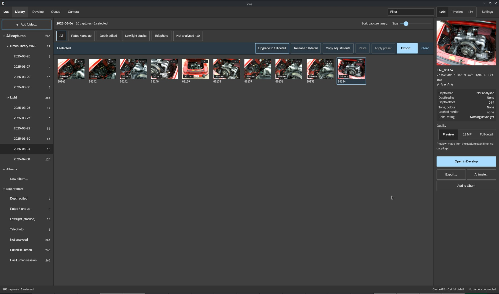
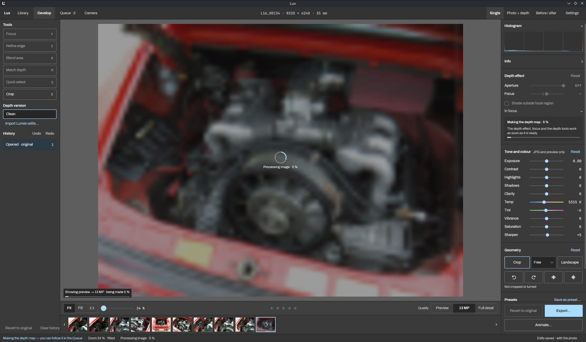
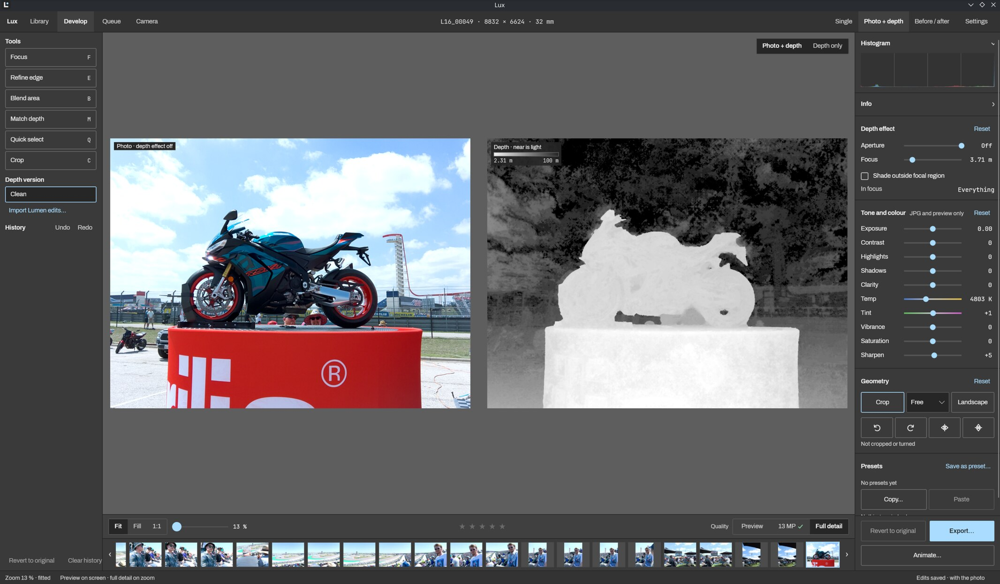
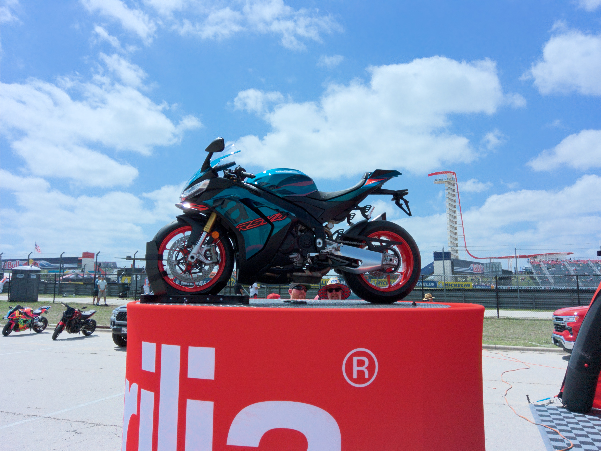
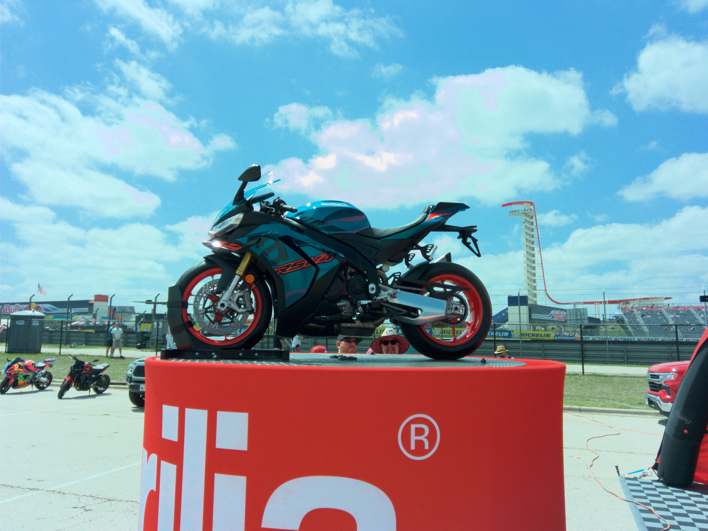
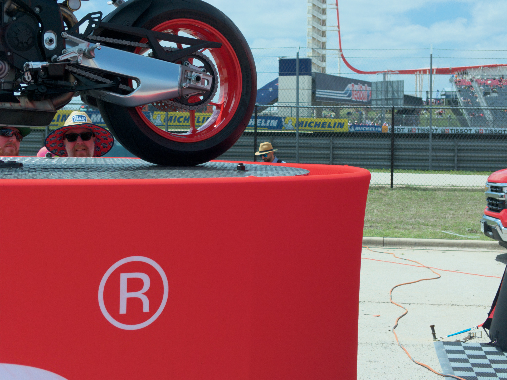
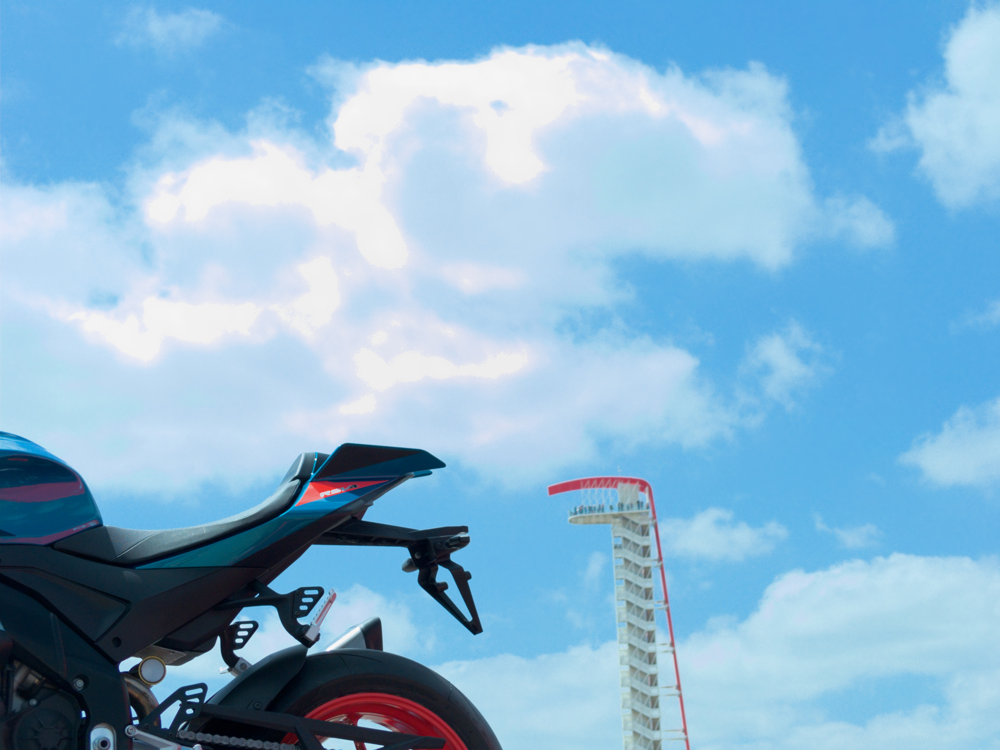
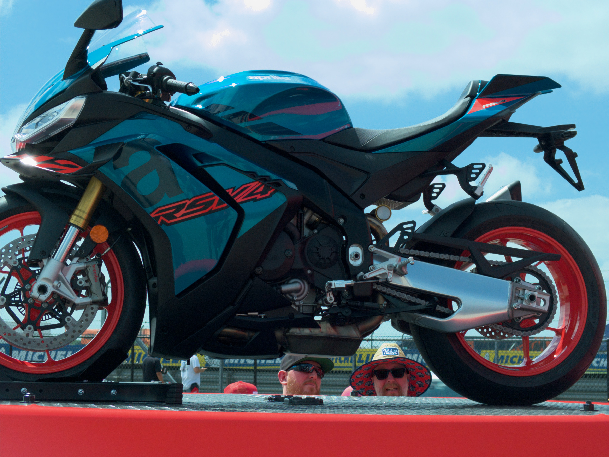
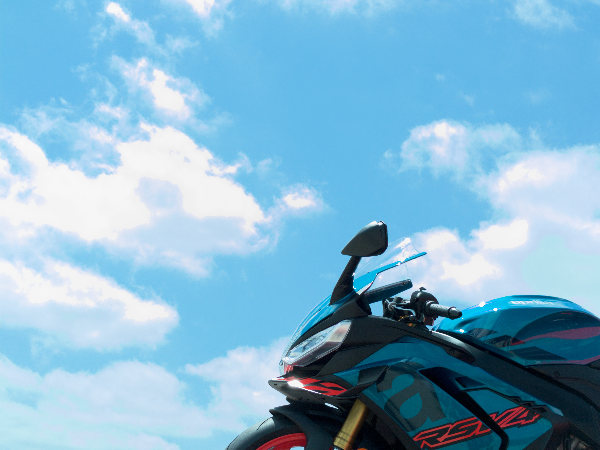
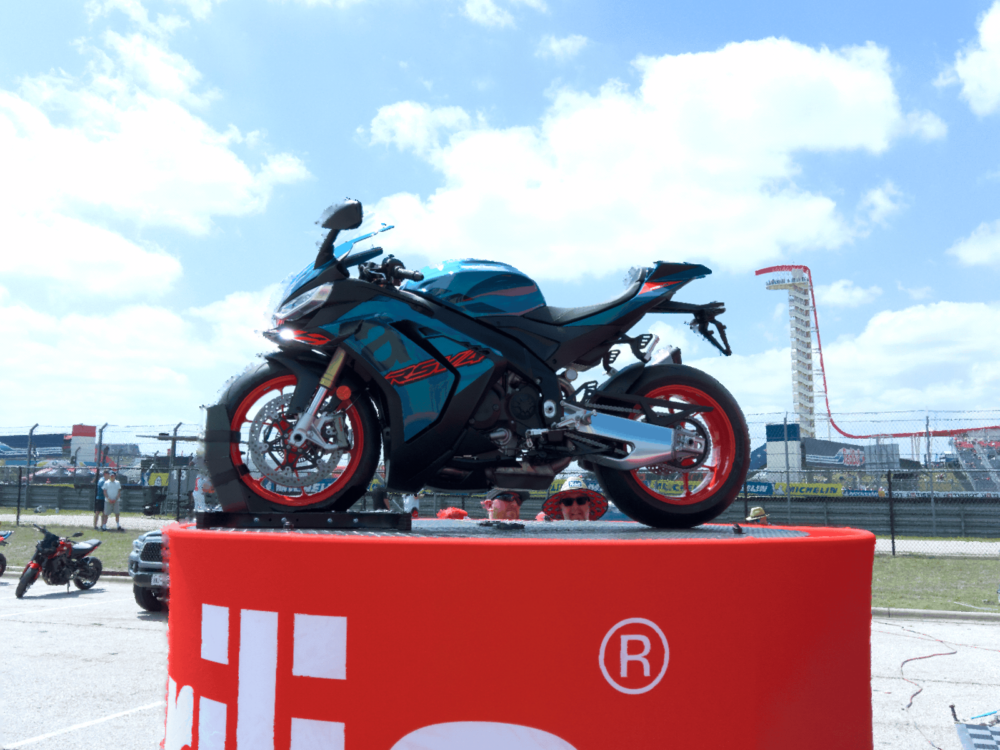

# Lux
Lux is an image processing utility for the Light L16 camera. It is an independent, cross-platform replacement for the original Lumen software. Its goal is processing that is pixel-exact to Lumen, with new features and improvements.

Lux has two programs:

- **Lux** is the desktop app. It has a photo library, an editor with Lumen's depth tools, exports and camera import.
- **`lux-light`** is the command line tool for conversion and batch work.

Both programs use the same engine and give the same output.

## Requirements
- [.NET 10](https://dotnet.microsoft.com/download/dotnet/10.0): the SDK is necessary only to build from source. The precompiled releases include
  the runtime and need no .NET install.
- [ffmpeg](https://ffmpeg.org/download.html) on PATH: necessary only for AVIF animations, `--parallax-encoder ffmpeg` and MP4 / WebM video (`animate --anim-container mp4|webm`).
  - Lux writes GIF, APNG and (lossless) WebP animations itself. If ffmpeg is necessary and Lux cannot find it, the CLI exits before it renders anything.
- libgphoto2: necessary only on Linux, and only for an MTP connection to the camera. Windows needs nothing more.

## Desktop app
The app runs on Linux, Windows and macOS (x64 and ARM64). Get it from the [Releases page](https://github.com/mprovenz/lux/releases). See [Build & run](#build--run) for the downloads.

- **Library:** add folders of captures and browse them as a grid, a timeline or a list. Filter and rate the captures, and group them in albums. The camera's motion sensor predicts which photos are blurred. These photos get a "possibly blurred" mark and a filter.
- **Develop:** the editor has these tools:
  - tone and color
  - crop and rotation
  - a Level button, which turns the photo by the angle that the camera's gravity reading suggests
  - the depth effect (aperture and focus)
  - Lumen's depth-editing tools (refine edge, blend area, match depth, quick select)
  - refined depth: an optional depth version in which a depth network corrects outlines, thin objects and the sky (see [Refined depth](#refined-depth))

  The editor can show a photo and its depth map side by side. A before / after view compares the edit with the original.
- **Quality per photo:** choose how much rendered detail Lux keeps for each photo (preview, 13 MP or full detail). Lux always keeps the depth map at full precision.
- **Export:** DNG, JPG, HDR and depth formats, and animations (rack focus, aperture sweep, wigglegram, parallax, lens tour, zoom-through, fog, pan and zoom, slice reveal, tilt-shift) with a preview.
- **Lumen sessions:** import the depth edits and settings that Lumen saved for a photo.
- **Camera:** list the photos on a connected L16 and import them (Linux and Windows).
- **Queue and settings:** one list shows all background work. You can adjust the thread counts, the memory and the number of jobs that run at the same time.

The library, with captures grouped by folder and day:

[](Samples/app/app-library.jpg)

One selected capture, with its details, its quality choice and its actions:

[](Samples/app/app-library-selection.jpg)

The Develop page:

[](Samples/app/app-develop.jpg)

A photo while Lux makes its depth map and a 13 MP copy. The progress shows over the picture and in the Queue.

[](Samples/app/app-develop-processing.jpg)

The focus tool. The shaded area is outside the focal region.

[](Samples/app/app-focus-tool.jpg)

A photo beside its depth map:

[](Samples/app/app-photo-and-depth.jpg)

## Features
- .DNG and .JPG outputs 1:1 with Lumen
- MTP device connection for querying storage and pulling images (tested on Linux and Windows)
- .HDR and .PPM export formats (the Lumen code contains them but never uses them)
- 16-bit TIFF, scene-linear floating-point TIFF and HDR gain-map JPG export formats (Lux formats; Lumen does not have them)
- GDepth and stereo depth map export
- Individual module image export (JPG only)
- Parallax effect animations and stills
- Full control over the image processing pipeline
- Bulk processing with multithreading
- Saved depth edits (see [Saved depth edits](#saved-depth-edits-the-luximagecontext-folder)):
  - Lux keeps the edits to a capture's depth map next to the capture. Every export uses them.
  - Lux can import what Lumen saved for a photo from its session files: the depth edits, the depth effect, the tone settings
    and the crop / rotation. After the import, Lux renders the photo as Lumen does.
- Refined depth (see [Refined depth](#refined-depth)): an optional step that corrects the outlines of objects, thin objects
  and the sky in the depth map with a depth network. The network is downloaded on first use. It is off by default.

## Projects
- **Lux.Engine** — the image-processing engine (`.lri` parse, module ISP, registration/depth, fusion, ResAmp,
  color profile, DNG/JPEG/HDR output, camera pull). Every front end uses its session layer (`Lux.Engine.Session`).
  The session layer has two parts:
  - `CaptureSession`: open a capture, render any region of any level, depth and focus queries, saved
    edits, exports, the analysis cache.
  - The exporter that `convert` runs on.
- **Lux.Cli** — `lux-light`. Its commands are `convert`, `inspect`, `profile`, `isp`, `isp-run`, `mod-info`, `devices`,
  `pull`, `version`, `edits-info`, `import-lumen-edits`, `cache`, `animate`, `depth-model`. `convert` produces pictures and
  `animate` produces animations. `convert` writes:
  - Lumen's formats: DNG, JPG, HDR, PPM and JPEG+GDepth.
  - The Lux formats that use the same render: the 16-bit TIFF, the scene-linear TIFF, the HDR gain-map JPG, the stereo depth
    pair, `lens-frames` and the experimental `parallax-*` animations and stills.
- **Lux.Library** — the photo library that the app uses: folders, albums, ratings, the job queue, edit sessions and camera import.
- **Lux.App** — the desktop app (Avalonia).
- **Lux.DepthModel** — the depth network of refined depth: the list of files it needs, their download into the app's data
  folder, and the inference. It calls the inference runtime through the runtime's C interface, so it adds no package.
- **Lux.Store** — what Lux keeps per capture on disk (the `LuxImageContext` folder): the depth-edit database and the
  analysis cache. This project has the SQLite dependency (`Microsoft.Data.Sqlite`), so the engine itself has none.

## Build & run
Precompiled builds for Linux, Windows and macOS (x64 and ARM64) are on the [Releases page](https://github.com/mprovenz/lux/releases).
Each build is self-contained, so no .NET install is necessary. Pick one:

| Download | What it is |
|---|---|
| `Lux-win-Setup.exe` | Windows installer for the app (per user, no administrator rights). Includes `lux-light`. Updates itself. |
| `Lux.AppImage` | Linux app as one file: make it executable and run it. Includes `lux-light`. Updates itself. |
| `lux-<version>-<platform>` (.tar.gz / .zip) | The app and `lux-light` as a plain folder. No installer and no self-update; on Linux a `lux.desktop` file and icon are included for your launcher. |
| `lux-light-<version>-<platform>` (.tar.gz / .zip) | The command line tool alone. |

The installed builds update themselves:

1. When the app starts, it checks this repository's releases.
2. It downloads a newer version in the background.
3. It applies the new version only when you choose to restart.

The binaries are not code-signed, so Windows shows a SmartScreen warning on the first run.

ARM64: the installed builds are `Lux-win-arm64-Setup.exe` and `Lux-linux-arm64.AppImage`. The plain archives have `win-arm64` and
`linux-arm64` in their names. The Linux and Windows ARM64 builds are not yet tested on ARM64 hardware.

macOS: use the plain archives, `osx-arm64` for Apple silicon and `osx-x64` for Intel. The first archive contains `Lux.app`, with
`lux-light` in `Lux.app/Contents/MacOS`. The macOS builds do not update themselves. They are not notarized, so macOS blocks a
downloaded copy until you remove the quarantine mark:
```
tar -xzf lux-<version>-osx-arm64.tar.gz
xattr -dr com.apple.quarantine Lux.app             # for the tool alone: xattr -d com.apple.quarantine lux-light
```
To use the command line tool alone:
```
tar -xzf lux-light-<version>-linux-x64.tar.gz      # a .zip on Windows
./lux-light convert <file-or-dir> [--out-directory out] [--formats all] [-j threads]
```
Camera import:

- On Linux, camera import uses the system's `libgphoto2` (package `libgphoto2-6` or similar). Without it, the rest of Lux works.
- On Windows, camera import uses the camera support that is part of Windows. Connect the L16 in file-transfer mode. You do not need to install anything.

Build from source (needs the .NET 10 SDK):
```
dotnet build Lux.slnx -c Release
./Lux.Cli/bin/Release/net10.0/lux-light convert <file-or-dir> [--out-directory out] [--formats all] [-j threads]
```
`packaging/pack.sh <version> <platform>` makes the release files. The platforms are `linux-x64`, `linux-arm64`, `win-x64`, `win-arm64`, `osx-arm64` and `osx-x64`. The script needs only the SDK. You can build the Windows installer on Linux.
The [full CLI usage instructions](#full-cli-usage-instructions) are at the bottom of this document.

Note: a full-size export of DNG and JPG takes 69 - 85 s and uses 7.7 - 9.1 GB of memory per file (average - maximum on a desktop processor with 24 threads). By default, `convert` processes inputs in parallel
with one thread per CPU. For a batch, pass `-j` with a count that keeps threads × 7G within your RAM.

## Status
- DNG and JPG are pixel-exact to Lumen. This excludes the dense-stereo race condition and assumes that Lumen processed the capture with no pre-existing .lris. The image data and the metadata values are Lumen's. Only the Exif layout is different (see [Verification status](#detailed-image-processing-pipeline-technical-reference)).
- Performance needs some work. A full-size export of DNG and JPG takes 69 - 85 s (average - maximum on a desktop processor with 24 threads).
- The tool is heavily tested on Linux and checked on Windows and on macOS (Apple silicon and Intel). The Linux and Windows ARM64 builds are published but not yet tested on ARM64 hardware.
- The desktop app is new in 2.0. Camera import in the app works on Linux and Windows. It is not tested on macOS.

## Sample Images
All samples come from one capture, `L16_00049`. `lux-light convert` wrote them, and they are in the repository under
[Samples/](https://github.com/mprovenz/lux/tree/main/Samples). Every image links to the full-size file on GitHub.

### Full-resolution JPG
The Lumen-identical JPG export (format `jpg`) at full size.

[](https://github.com/mprovenz/lux/blob/main/Samples/L16_00049.jpg)

### Depth map
The stereo depth map (format `depth`): the JPG half of the `<stem>_depth.f32` + `<stem>_depth.jpg` pair, on the exported grid.

[](https://github.com/mprovenz/lux/blob/main/Samples/L16_00049_depth.jpg)

### Lens frames
Each module of the capture as its own display JPG (format `lens-frames`). The capture has the five 28 mm A modules and
the five 70 mm B modules. A2 is the monochrome module.

| A1 (28 mm) | A2 (28 mm, monochrome) | A3 (28 mm) | A4 (28 mm) | A5 (28 mm) |
|---|---|---|---|---|
| [](https://github.com/mprovenz/lux/blob/main/Samples/L16_00049_A1.jpg) | [](https://github.com/mprovenz/lux/blob/main/Samples/L16_00049_A2.jpg) | [](https://github.com/mprovenz/lux/blob/main/Samples/L16_00049_A3.jpg) | [](https://github.com/mprovenz/lux/blob/main/Samples/L16_00049_A4.jpg) | [](https://github.com/mprovenz/lux/blob/main/Samples/L16_00049_A5.jpg) |

| B1 (70 mm) | B2 (70 mm) | B3 (70 mm) | B4 (70 mm) | B5 (70 mm) |
|---|---|---|---|---|
| [](https://github.com/mprovenz/lux/blob/main/Samples/L16_00049_B1.jpg) | [](https://github.com/mprovenz/lux/blob/main/Samples/L16_00049_B2.jpg) | [](https://github.com/mprovenz/lux/blob/main/Samples/L16_00049_B3.jpg) | [](https://github.com/mprovenz/lux/blob/main/Samples/L16_00049_B4.jpg) | [](https://github.com/mprovenz/lux/blob/main/Samples/L16_00049_B5.jpg) |

### Parallax animations
Animated GIFs synthesized from the same capture.

#### Parallax wiggle
Format `parallax-wiggle`: the color A-module frames, color-matched and swept in spatial order. Module renders only, no registration.

[](https://github.com/mprovenz/lux/blob/main/Samples/L16_00049_parallax-wiggle.gif)

#### Parallax wiggle, interpolated viewpoints
Format `parallax-wiggle-interp`: virtual viewpoints along the rig's axis, synthesized from the depth, with disocclusions filled from the other real modules.

[](https://github.com/mprovenz/lux/blob/main/Samples/L16_00049_parallax-wiggle-interp.gif)

#### Parallax orbit
Format `parallax-orbit`: the same synthesis on a closed circular path.

[](https://github.com/mprovenz/lux/blob/main/Samples/L16_00049_parallax-orbit.gif)

#### Parallax single-view
Format `parallax-single`: single-view 2.5D, the sweep with no multi-view fill.

[](https://github.com/mprovenz/lux/blob/main/Samples/L16_00049_parallax-single.gif)

## Detailed image processing pipeline technical reference

A Light L16 `.lri` is a container of 10–16 independent camera frames, one for each module that fired. A stacked low-light
capture has several frames per module. To produce one image is therefore a
multi-camera fusion problem, not a single-sensor develop. The pipeline runs in five phases:

1. **load**
2. **per-module ISP**
3. **registration + depth**
4. **fusion**
5. **export render**

Only the last phase differs between output formats. All formats share one `PipelineCache`. The fusion render is ~74 % of
the wall-clock time, so four formats cost only a little more than one.

Verification status:

- The pictures are pixel-identical to Lumen's.
- In DNG, JPEG and JPEG+GDepth, the image data is byte-identical to Lumen's. This includes the embedded depth map.
  Each metadata tag has Lumen's value.
- The Exif block is different in two ways, on purpose:
  - The capture dates. Lumen writes the capture dates (DateTimeOriginal, CreateDate and the OffsetTime tags) into the wrong
    directory. Some programs then do not find the capture date. Lux writes them into the Exif directory, where the Exif
    standard puts them.
  - The Exif version. Lumen declares Exif version 2.30. Lux declares 3.0.
- The export timestamp is the time of the run.
- PPM and Radiance HDR are byte-identical to Lumen.
- The output does not depend on the CPU. Lumen's kernels use the approximate reciprocal and reciprocal square root
  (SSE `rcpps`/`rsqrtps`). The result tables of these instructions differ between CPU vendors. Lux computes both from a
  fixed table model. Thus an AMD host produces the same bytes as an Intel host, and the same bytes as Lumen on Intel
  hardware.

---

### 1. Container and load

#### 1.1 Container

`.lri` is a chain of `LELR` blocks. Each block has a 32-byte header (magic, `u64` block length, `u64` message offset,
`u32` message length, `u8` type) and then a protobuf message. The block types are:

- Type 0 = `LightHeader`. It is merged across blocks and has a `CameraModule` for each camera.
- Type 1 = `ViewPreferences`.
- Type 2 = `GPSData`.

Frame data is at `blockBase + surface.data_offset`.

`CameraID` identifies the modules: **A1–A5** (28 mm), **B1–B5** (70 mm), **C1–C6** (150 mm). The header's
`image_reference_camera` names the reference module. The reference module selects several downstream branches.

#### 1.2 Surface formats

| format | layout | decode |
|---|---|---|
| `RAW_PACKED_10BPP` | 10-bit packed Bayer, 8 px per 10 bytes | bit unpack |
| `RAW_BAYER_JPEG` | `BJPG` container: header, encoder compand LUT, 256-entry `u16` dequant LUT, then baseline JPEG streams | TurboJPEG `JDCT_ISLOW`, `TJPF_GRAY`, then dequant + scatter |

The CFA selects the Bayer-JPEG variant:

- Version 0 stores **four half-resolution planes, one per CFA site**
  (scattered back as `dst[(2y+(p>>1))·stride + 2x + (p&1)]`). Thus the DCT never sees the mosaic pattern.
- Version 1 stores **one full-resolution plane**. Only the monochrome module uses it, because that module has no
  pattern to split.

#### 1.3 Stacked captures

In low light the camera writes **N frames per module**. Each frame has its own `CameraModule` block, and
`frame_index` identifies it. Observed stacks always have 4 frames with identical exposure, gain, lens and mirror position.
`lt::StackFusion` merges the frames of each module before all other processing. The merge is the same 16×16 wavelet
block merge that the inter-module fusion uses, with per-frame optical flow, outlier rejection, Hann-window
accumulation and ÷N. Frame 0 is the reference. There is **no exposure-ratio term**: the algorithm assumes identical
frames, and the camera produces identical frames.

Consequence: for a stacked capture, the module ISP sets `hot_pixel_removal`, `hot_pixel_leakage_removal` and
`highlight_restore` to `none`. The stack merge rejects transient outliers better than a single-frame spatial
filter can. The dedicated stages are therefore off, so that they cannot damage real detail.

#### 1.4 Load-time state

The pipeline derives these values once per capture and uses them in all phases:

- **AsShotNeutral**: from the reference module's color calibration at the capture CCT/tint.
- **BaselineExposure**: log₂ of the gain·integration-time ratio.
- **`lens_shading.multiplier`**: from CFA site histograms of the reference frame.
- **Black level** estimates, one per frame.

---

### 2. Per-module ISP (`lt::SoftISP`)

The module ISP runs independently on each module's Bayer frame, in the Bayer domain. It runs at a *config level*,
which selects the resolution and the denoise strength. The stage order as executed (level 0, color module):

| # | stage | algorithm | purpose |
|---|---|---|---|
| 1 | `HotPixelRemoval` | per-CFA-site ring/diagonal comparison against σ-tables at the frame's gain; candidate when `excess > σ[base]·k·4` | remove stuck sensor sites |
| 2 | `HighlightRestore` | reconstruct clipped channels from unclipped neighbors | recover blown highlights |
| 3 | `Placeholder` (linearize) | black subtract, normalize by `1/(white−black)`, apply WB scale | to normalized float |
| 4 | `CrossTalkCorrection` (`ir_correction`) | IR blend estimated from R/B site ratios | remove IR contamination |
| 5 | `Demosaicking` | `light_v1` (gradient-directed) at full res; `collapse2/4/8` (box-collapse) at lower levels | Bayer → RGB |
| 6 | `ColorNoiseReduction` | vec4 Gaussian/Laplacian pyramid, 5-tap `[.05 .25 .4 .25 .05]` | chroma denoise |
| 7 | `AdaptiveDesaturation` | shadow/highlight cutoff-driven saturation roll-off | tame extreme chroma |
| 8 | `Denoising` (`hybrid`) | bilateral + patch NLM over an STD plane, window 3/5/7/9 by ISO | luma denoise (off at level 0) |
| 9 | `PostProcessing` | sharpen / local contrast | detail |
| 10 | `LensShading` | calibrated per-module vignetting grid | flat field |

Branches: stages 1–2 are gated on **frames-per-stack < 2**, not on sensor color. In Lumen, the monochrome module (A2,
`sensor_bayer_red_override = (-1,-1)`) never runs this ISP. Its path is the fusion path. The CFA-dependent
stages of this ISP therefore have no defined behavior on the monochrome module.

---

### 3. Registration and depth

#### 3.1 Sparse registration

`StereoAsyncApi` builds the geometric relationship between modules:

1. **Setup** — per-camera crops, view poses, and the initial `AlignedCalib` pair from factory calibration.
2. **Feature matching**, per pyramid level, per non-reference camera:
    - top level, A-reference: `initLowerACamera<8>`. It uses 8×8 templates. Calibration and plane depth guide the prediction.
    - top level, B4/C5 reference: `initLowerBCamera<8>`. It uses no calibration and no plane depth. The prediction is
      `ref − offset`. The search is a ±`w/4` epipolar band of half-width 5. The scoring is **zero-mean SAD**.
    - lower levels: `matchFeaturesPerLevelLowerCams<8>` / `…HigherCams<12>`.
      Constants: Lowe ratio 0.8, reverse ratio 0.95, score 10.0.
3. **RANSAC gate** — per-view inlier selection with distinct thresholds for the two views.
4. **Bundle adjustment** — `LightBA` over the observation set, then per-camera write-back for cameras with ≥ 26
   usable observations.
5. **Mirror-angle refinement** — coarse angular search for the movable-mirror B/C modules.

Output: per-camera `(view, module)` `AlignedCalib` pairs.

#### 3.2 Dense depth

The dense stage has two steps:

1. A truncated-SAD cost volume and **semi-global matching** on the half-resolution green plane.
2. `DenseUpsampleLayer`: a guided upsample against a `ReferenceGuide`, which is built from the reference frame. The
   result is a full-frame inverse-depth image that covers the whole canvas.

Note: Lumen's dense stage is **run-to-run non-deterministic**. Two runs over the same capture disagree in ~1 500 of
3.2 M level-5 samples.

---

### 4. Fusion

#### 4.1 Level 1 — `PackedBayerFusion`

`PackedBayerFusion` merges the reference-group modules onto the reference grid. It is a 16×16 block wavelet merge
with these steps:

1. Per-block optical flow (`BlockFlow`) against the reference.
2. CDF-style wavelet decomposition.
3. Coefficient `Shrink`, driven by the sensor noise model at the frame's gain.
4. Hann-window accumulation.
5. Normalization by the contributor count.

The pyramid depth is 4 levels (5 for a C-group reference, which is unreachable in practice).

`MonoFusion` adds the monochrome module's luminance detail to the color result over a 5-level wavelet pyramid.

#### 4.2 Level 0 — `ImageResolutionAmp`

`ImageResolutionAmp` is a super-resolution step. It uses the higher optical group (B for an A reference, C for a
B reference). Its steps are:

1. Coarse alignment.
2. CDF 9/7 analysis.
3. Per-module preparation and warping through the dense depth (`WarpField`).
4. Merge and inverse merge.

This step turns 13 MP sensors into a 52 MP output.

---

### 5. Color

`LumenProfile` computes, per capture:

- **Illuminant entries** — every `ColorCalibration` of the reference module, with CCT/tint from its (x, y).
- **ColorMatrix 1/2** — the proto `color_matrix` of the lowest- and highest-CCT entries, verbatim.
- **ForwardMatrix 1/2** — a **refit**, not the proto value: a Ceres line-search optimization over Lab error using
  the Macbeth reference data.
- **HueSatMap 1/2** — a 32×32×1 hue/saturation/value LUT from a thin-plate-spline fit of the same data, in linear
  ProPhoto D50.
- **Tone curve**, **AsShotNeutral**, **BaselineExposure**.

---

### 6. Export

#### 6.1 Geometry (all formats)

`setInputDataStream` sets the canvas: `canvas = (int)(sensor · f)`, snapped to the sensor's 64×48 aspect grid.
`f` is the focal ratio of **the next optical group up over the reference group**: 70/28 = 2.5 for an
A reference, 150/70 ≈ 2.143 for a B reference. Export level 0 is `crop × canvas`, also snapped. The crop comes
from `ViewPreferences`. The pipeline builds five levels. Each level is half the size of the level before it.

`GetExportTransformOutput` then resolves a requested output size to a source level, a source rect and a scale. The
scale selects the resampler:

- When `scale > 1.5`, the resampler is a separable **Lanczos-2 blur followed by bilinear warp**.
- Otherwise, the resampler is a 64-phase **Catmull-Rom** (`ImageWarpClamped<2>`).

#### 6.2 Per-format paths

The output ISP is gated on `(fmt | 4) == 4`. Thus **only JPEG and JPEG+GDepth re-run it**. Formats 1, 2 and 3 take
the float render directly.

| fmt | output | path |
|---|---|---|
| 0 | JPEG | output ISP → 8-bit → libjpeg-turbo baseline, quality 98, 4:2:0, standard Huffman tables, Exif + `LibCP` comment |
| 1 | PPM | float → `×255`, `cvtps2dq` (round-half-to-even), saturate → `P6` header + flat RGB |
| 2 | DNG | float tiles → vignetting removal → resample → `×16384` → lossless JPEG (SOF3, predictor 1) tiles → DNG container |
| 3 | Radiance HDR | float → RGBE, flat uncompressed, `#?RADIANCE` header; **scene-linear camera raw**, not display-referred |
| 4 | JPEG + GDepth | fmt 0, plus the depth map as XMP |

#### 6.3 Output (display) ISP — formats 0 and 4 only

The output ISP runs in the Color domain on the fused tile, with a constant halo of 64:

| slot | stage | algorithm |
|---|---|---|
| 2 | ÷ neutral | divide by AsShotNeutral |
| 10 | `ColorCorrection` (`optimized`) | matrix + CCT-interpolated HSV LUT, 33×33 bilinear hue/sat, in linear ProPhoto D50, gamut clip |
| 11 | `PostProcessing` | saturation and vibrance (in Lab, hue-dependent), sharpen or soften |
| 12 | `LensShading` (`inverse`) | re-apply shading model inverted |
| 13 | `ToneAdjust` (`laplacian_pyramid`) | local Laplacian tone adjustment |
| 14 | `ContrastAdjust` | `0.217·(x/0.217)^(2^(0.3a))` via fast log2/exp2 |
| 15 | `ToneMapping` | ACR-family LUT + `RGBTone` hue preservation, then ProPhoto → sRGB |

A renderer flag selects the tone-mapping variant (`light_v1` / `light_v2` / `acr`). The flag differs between the
GUI and a headless render. Lux implements both branches.

#### 6.4 Color-space property

Lumen's export sets its color space setting from the format:

- `fmt ≤ 1 → 4 (sRGB)`
- `fmt == 2 → 0 (none)`
- `fmt == 3 → 1 (linear sRGB)`
- Any other format throws. For this reason, format 4 is unreachable from Lumen's UI.

A DNG therefore has `ColorSpace = 65535` and no Interop IFD. A JPEG has `ColorSpace = 1`. For formats 1–3 the
setting is **inert**: those paths never read the output tuning.

#### 6.5 GDepth (format 4)

The depth map comes from a dedicated double-buffered depth image cache at **pipeline level 1**. The cache holds
`InverseDepthClip(ImageResample<0>(InverseDepth(fullDepth)), 100000)`: metric millimeters, resampled nearest in
inverse-depth space, clipped at 100 m. The export then does these steps:

1. It warps the depth map to the export grid with the same transform as the color image.
2. It scans the depth map for `Near`/`Far`.
3. It quantizes the depth map to 8-bit with the formula below.
4. It encodes the result as a grayscale JPEG.
5. It writes the JPEG as base64 into `GDepth:Data`.
6. It splits the data across extended-XMP APP1 chunks of 65 458 bytes.

```
E = recip(d·(far − near)) · (d − near) · (255·far)
```

`Far` is always the 100 m clip constant, not a scene value. The top of the range is therefore coarsely quantized.

Inverse mapping, for consumers: `d = far·near / (far − u·(far − near))` with `u = E/255`.

---

### 7. Modification options

| option | effect |
|---|---|
| export size / level | selects the source level and resampler via `GetExportTransformOutput` |
| crop | from `ViewPreferences`; sets export level 0 relative to the canvas |
| rotation | baked into the transform; `Orientation` stays 1 |
| tone mapping type | `acr` / `light_v1` / `light_v1_lowlight` / `light_v2` |
| compression | DNG: uncompressed strips or lossless JPEG tiles |
| color space | the color space setting of Lumen's export (§6.4); only the JPEG path uses it |
| exposure / f-number / ISO / focal | Exif values; `AllInFocusFNumber` is computed as `aperture · equiv35 / physical` |
| tone & color | the editor's sliders (exposure, contrast, temperature, tint, vibrance, saturation, sharpening) and shadows / highlights / clarity, each mapped onto the output-ISP stage it drives (§6.3); also highlight recovery and gamut compression, which are Lux processing in the tone stage; JPEG path only |


## Where Lux keeps a photo's data

Lux keeps everything that it saves about a photo **next to the photo**, in a folder named `LuxImageContext` (described below).
This data is your depth edits, the saved settings, the rating, and the analysis that makes later opens and exports fast.
The data therefore moves with your captures and stays valid when you rename them.

**When Lux cannot write next to a photo.** Examples are a read-only drive, a card with the lock switch on, and a shared folder that
you may only read. Lux then keeps the same files **on this computer**, in a folder of the desktop app's data:

- The default folder is `~/.local/share/Lux/contexts` on Linux and `%APPDATA%\Lux\contexts` on Windows.
- You can choose another folder in the app's settings. The contents move with it.

You lose nothing and you do not need to do anything:

- When the photo's folder can be written again (the drive is mounted read-write, the permission is fixed), the app moves the data
  next to the photo by itself. It checks every byte before it removes its own copy.
- If the photo's folder got data of its own in the meantime (for example, the same drive was edited on another computer), Lux
  keeps the data next to the photo. Lux sets its local copy aside and does not delete it, so you can still recover it.

**`lux-light` reads both places.** A `convert` therefore uses the edits that the app saved for photos on read-only drives. If the
app's data is not in the default place, set `LUX_APP_DATA` or `LUX_CONTEXT_STORE`. `convert` itself never creates any of these
folders.

To find the app's local folder, `lux-light` does this:

1. It reads one small file that the app keeps beside its library, `context-store-folder.txt`. The app writes this file when it
   opens its library and each time you change the folder.
2. If that file is missing (a library that the current app has not opened yet), it reads the one setting from the library database
   in SQLite's read-only "immutable" mode.

In both cases `lux-light` writes nothing in the app's folder: no `-shm` / `-wal` files and no changed file times.

For testing and portable set-ups:

- `LUX_APP_DATA` moves the app's whole data folder.
- `LUX_FORBID_DEFAULT_APP_DATA=1` makes any program of the suite stop with an error instead of using the per-user folder.

The test tools set both, so a test can never reach your own library.

## Saved depth edits (the `LuxImageContext` folder)

Lux keeps what it knows about a capture, other than the `.lri` itself, in a folder named **`LuxImageContext`**, next to the captures:

```
<folder with your .lri files>/
  LuxImageContext/
    edits/    one file per edited capture (<long hexadecimal name>.luxedits) — your depth edits. Keep this folder.
    cache/    data Lux can compute again at any time. Safe to delete.
```

- **`edits/` is your work.** It holds every depth edit that you made, losslessly. It also holds the depth map that the edits
  were made on and the list of editing steps. No clean-up in Lux removes it. Back it up with the captures. If you move captures
  to another folder, move the `LuxImageContext` folder with them.
- **Files are matched by content, not by name.** The name of each `.luxedits` file is a fingerprint (SHA-256) of the capture
  file's content. If you rename a `.lri`, it keeps its edits. If a different capture gets the old name of another file, it does
  not get the edits of that file.
- **Nothing is created until there is something to save.** A plain `convert` never creates the folder. A capture without saved
  edits converts exactly as it does without this feature.
- **Variants.** One capture can hold more than one set of edits. Each set is a variant. Exactly one variant (or none) is active:
  - `lux` — edits made in Lux. They start from Lux's own depth map and keep the full list of steps, so undo works across
    sessions.
  - `lumen-import` — a Lumen session file imported with `lux-light import-lumen-edits`. It holds the depth edits of the session
    (if it has any) and the photo's settings from Lumen (see below).

  A change of the active variant (`lux-light edits-info <lri> --set-active <variant>`) never deletes the other variants.
  `--set-active none` and `convert --no-edits` always give the clean, unedited picture.
- **Edits are checked when they are loaded.** Every stored block has a checksum. `lux-light edits-info <lri>` lists what is
  stored and reports each damaged block. Sometimes the saved list of editing steps can no longer reproduce the saved result
  (for example after damage). Lux then keeps the saved result as it is and switches off only the undo into earlier sessions.

**What an import brings over from Lumen.** Lumen keeps a session file (`.lris`) next to every photo that you opened or exported.
When Lumen reopens a photo, it does not compute the picture again from the `.lri`. It restores the picture from the session file.
`import-lumen-edits` brings everything in that file into the photo's `LuxImageContext`. After that, `lux-light convert` with no
options produces the picture that Lumen produces after it reopens the session. The import brings over:

- the depth map that Lumen stored and the camera geometry that it computed (Lux assembles the picture with them, exactly as Lumen does);
- the depth edits made with Lumen's depth tools, if there are any;
- the depth effect: the aperture (f-number) and the focus distance that you set;
- the tone and color settings: exposure, white balance (temperature and tint), contrast, saturation, vibrance and sharpening
  (they affect the JPG; a DNG holds the unprocessed image, as from Lumen);
- crop and rotation, and the full-size output size that Lumen uses for them;
- the star rating (`edits-info` shows it; it does not change the picture).

Each option that you give to `convert` replaces only that setting. For example, `--f-number 4` keeps the saved focus, tone and crop.
`--no-edits` ignores everything saved. Photos without a `LuxImageContext` folder convert exactly as they do without this feature.

Lumen does not write one thing into the session file: the tone rendering that its own window used when it exported. Lumen 2.3 as
it ran in 2025 exported with its "v2" tone curve. To reproduce those DNG and JPG files byte for byte, add
`--jpeg-v2 --dng-tone light_v2` to `convert`.

> **About edits imported from Lumen.** Edits imported from Lumen use the depth map that Lumen stored in its session file. That depth
> map is slightly less precise than the one that Lux computes, because Lumen stores it in a compact, rounded form. The results
> therefore have lower fidelity than a new edit from a clean Lux start. In return, the imported variant renders exactly as Lumen
> does after it reopens that session. The clean Lux depth is still there: `--no-edits` renders without any edits or saved settings.
> You can start a clean `lux` variant beside the imported variant at any time.

Example:

```
lux-light import-lumen-edits ~/Pictures/L16            # every .lris whose .lri is beside it
lux-light edits-info ~/Pictures/L16/L16_00493.lri      # what is saved, which variant is active, is it intact
lux-light convert ~/Pictures/L16/L16_00493.lri         # the photo as Lumen shows it: edits, depth effect, tone, crop
lux-light convert ~/Pictures/L16/L16_00493.lri --f-number 2             # the same with another aperture
lux-light convert ~/Pictures/L16/L16_00493.lri --no-edits               # the clean picture, nothing saved applied
```

## Refined depth

The camera's depth map has real distances, but it has typical faults: its depth steps sit beside the outlines of objects, it
loses thin objects such as fence bars, it fills the gaps between railing bars, and it scatters the sky over many distances. A
depth network sees outlines, thin objects, gaps and the sky in the picture, but it gives no real distances. Refined depth joins
the two.

- **What it does.** Lux runs the network on the capture's own picture: once on the whole picture, and once more on overlapping
  tiles at twice the scale for fine detail. Lux then keeps the camera's depth, except in two places: in the sky, which goes to the
  far limit, and where the local shape of the camera's depth contradicts the network. There, each pixel takes the trusted camera
  depth nearby that belongs to the same surface in the network's view. Only where no such depth exists (a thin bar that the
  camera's depth does not contain) does a pixel take the network's value, mapped to a distance.
- **The other cameras check the depth.** Lux renders the other cameras that have the same view as the reference camera, and
  compares each with the reference camera at the place that the camera's depth predicts. Depth that the other cameras contradict
  is not trusted. Depth that they confirm is never rewritten outside the sky, also where the network sees another shape: a
  printed picture on a wall stays flat.
- **The sky.** The sky is where the network sees the farthest thing in the picture. Three checks apply. A place where the
  detailed pass sees something nearer is not sky. A thin, sharp line in the picture (a wire, a mast, an antenna) is not sky and
  keeps its depth. A connected area is sky only when the camera's depth on it is far (a median of 11 m or more): the far wall of
  a room is not sky.
- **Telephoto captures.** A capture whose reference camera has no other cameras with the same view gets only its sky corrected.
  The same applies to a capture with too little trusted depth.
- **What it changes.** Typically a few percent of the depth map: outlines, thin objects, gaps and the sky. Every other pixel keeps
  the camera's depth, bit for bit. The picture itself, the registration and the fusion of the cameras do not use refined depth.
- **Where it is used.** The outputs that read the depth: the depth effect (`--f-number`), `jpg+depth`, `depth` and the depth-based
  parallax formats.
- **It is opt-in.** Without `--depth-refine` (command line) or "Refine depth" (app), nothing changes.
- **Its limits.** It does not repair depth that is wrong over a large area, and it does not make far depth more exact. An object
  that is out of focus close to the camera, a semi-transparent net and reflections in glass can come out wrong. A wide, bright
  object in front of a hazy sky can become sky. A smooth surface inside a window frame or behind a net can move farther away.
  The sky behind window glass often stays as it is. A rim of a few pixels beside a skyline or a thin object keeps the camera's
  depth. Check the result.

**The files.** Refined depth needs two files that are not part of Lux. Lux downloads them on first use, about 105 to 110 MB,
into `models/depth` in the app's data folder, and checks each against a fixed SHA-256:

| File | License | Source |
|---|---|---|
| Depth Anything V2 Small, the depth network, as an ONNX file | Apache-2.0 | The `onnx-community/depth-anything-v2-small` repository on Hugging Face, at a fixed revision |
| ONNX Runtime 1.23.2, the library that runs the network | MIT | The release files of the Lux project at github.com/mprovenz/lux-depth-support; second source: the `Microsoft.ML.OnnxRuntime` package on nuget.org |

ONNX Runtime 1.23.2 has builds for Linux, Windows and macOS on x64 and arm64 processors. On another computer Lux says that
refined depth is not available. Lux downloads the one library of your computer, 5 to 12 MB, from the release files of the Lux
project (github.com/mprovenz/lux-depth-support). These files hold the unchanged libraries of the `Microsoft.ML.OnnxRuntime`
1.23.2 package. When that download fails, Lux takes the same library from the package on nuget.org. A download sends the file's
address, the byte range and a generic client name, nothing else.

**In the app.** Settings has a "Refined depth" section: the state of the files, "Download", "Remove" and the folder. In Develop,
"Refine depth" under "Depth version" makes a version named "Refined" of the photo's depth and shows it. The first time, the app
asks before it downloads the files. The refined version is a depth version like the others: you can switch between it and the
clean depth, edit it with the depth tools, and exports use the version that is active. It is stored with the photo, so it is
made once and does not need the files again. A later version of Lux with other refinement rules does not change a stored
refined version.

**On the command line.** `lux-light depth-model install` downloads the files (`status` and `remove` do what they say).
`convert --depth-refine` then refines the depth for that export; nothing is stored. A capture with saved depth edits keeps
those, and a capture whose active version is the app's "Refined" version uses it as saved.

```
lux-light depth-model install
lux-light convert ~/Pictures/L16/L16_00493.lri --depth-refine --f-number 2 --formats jpg
lux-light convert ~/Pictures/L16/L16_00493.lri --depth-refine --formats depth
```

**The same result every time?** On one computer, yes. Between computers the network's output can differ in its last digits,
because ONNX Runtime uses the instructions of each processor. Everything around the network uses the engine's exact arithmetic.

## The analysis cache (`LuxImageContext/cache`)

Most of the time of a full-size export goes into work that depends only on the capture:

- The registration: Lux computes the exact geometry of the sixteen cameras and the depth map. This is about half of a
  full-size export.
- The fusion of the modules into the 13 MP image.
- The build of the full-size image.

Lux can keep the results in the capture's `LuxImageContext/cache/` folder. The next export, preview or edit of that capture
then starts from them. **The cache only saves time: an export from a cached capture is byte-identical to one computed from
scratch.** The reason is that the cache holds the pipeline's own intermediate data, stored losslessly.

A capture's cache has a level. Each level includes the levels before it:

| Level | What is kept | What it saves | Size (typical, compressed) |
|---|---|---|---|
| `geometry` | the camera geometry and the full-resolution depth map | the registration, in every later export; anything that reads the depth (depth effect, `jpg+depth`, `depth`) | 14–17 MB |
| `13mp` | also the 13 MP linear image and the previews (levels 2–4) | the fusion: 13 MP exports and previews run only the output stage | +49–57 MB |
| `full` | also the full-size linear image under the export window | everything but the output stage of a full-size export (about 10 s instead of 69 - 85 s) | +180–205 MB |

```
lux-light cache ~/Pictures/L16/L16_00493.lri                  # what is kept, and how big it is
lux-light cache ~/Pictures/L16/L16_00493.lri --level 13mp     # raise it (computes what is missing)
lux-light cache ~/Pictures/L16 --level geometry              # a whole folder
lux-light cache ~/Pictures/L16/L16_00493.lri --level none     # remove it
```

- **Keyed by content and by engine version.** The name of the cache file is the capture's SHA-256, as for the edits. The file
  records the version of the engine's cache format. Lux never uses a cache written by another version: it discards and rebuilds it.
- **Checked on every read.** Every stored block has a checksum of its data. Lux never uses a damaged block. It computes the
  block again for the current export and marks its level incomplete (`cache` shows it, `cache --level` rebuilds it).
- **Safe to delete at any time.** Lux computes again whatever is missing. Lux never removes anything automatically.
- **`convert` uses whatever a capture's cache holds.** When the capture already has a `LuxImageContext` folder (made by the
  `cache` command, by saved edits or by the desktop app), `convert` also keeps the geometry and depth that it computed. The next
  export then skips the registration. `convert` never creates that folder by itself. `--no-cache` turns the cache off for a run.
- **Memory.** A full-size export of DNG and JPG peaks at 7.7 - 9.1 GB (average - maximum; about 3 GB from a `full` cache). `--memory-budget <GB>` trades time for
  memory with the same output:
  - On a wide capture, 4 GB took +25 % time and 3 GB took +80 % time.
  - A stacked (night) capture does not go below about 5 GB (+50 % time at a 4 GB budget).

## Full CLI usage instructions
### USAGE

```
lux-light <command> [options] [input...]
lux-light --help
```

### COMMANDS

| Option | Description |
|---|---|
| `convert <input...>` | Process a .lri and export it as Lumen does. The image pipeline runs once, and convert writes the result in any combination of export formats (see below). All values come from the .lri. Only the options marked * change Lumen's output. `--level`, `--size` and `--origin` only select the output grid |
| `inspect <input...>` | Print the state that Lux derives when it loads a capture (neutral, ev, multiplier) |
| `mod-info <input...>` | Print the CameraID, gain, exposure, frame black and relative_brightness of each module |
| `profile <input...>` | Compute and print the color profile (matrix fit, ForwardMatrix, HueSatMap) |
| `isp <input...>` | Print the module-ISP tuning per config level, the stage list and the white-balance state |
| `isp-run <input...>` | Run the module ISP on a center region and write a gamma-encoded PPM |
| `devices` | List the connected MTP cameras |
| `pull [options]` | Copy matching files from the camera |
| `version [--offline]` | Print the version of this build and check GitHub for a newer release |
| `edits-info <input...>` | Show the saved depth edits of a capture: the variants, the active variant, the amount of stored data, and whether all stored data is intact. `--set-active <variant\|none>` selects the variant that `convert` uses |
| `import-lumen-edits <lris file or folder...>` | Import Lumen session files (.lris) into Lux. An import contains what Lumen saved for the photo: the depth map and depth edits, the depth effect, the tone and color settings, the crop / rotation and the rating. convert then renders the photo as Lumen does. The capture of each session (the .lri of the same name) must be beside it |
| `animate <input...> --anim-effect <effect>` | Make an animation of each capture, as the desktop app does. The effects are:<br>rack-focus and aperture-sweep: Lumen's depth effect. Each frame is exactly the still that convert writes with `--f-number` and `--focus-depth`.<br>wigglegram: the pictures of the wide lenses.<br>parallax: a small camera move made from the photo and its depth.<br>lens-tour: each lens in turn.<br>zoom-through: a zoom from the whole picture onto telephoto detail.<br>fog: depth fog that moves through the scene.<br>pan-zoom: a push-in with a moving camera, made from the photo and its depth.<br>slice-reveal: the colors come in slice by slice of distance.<br>tilt-shift: a miniature look with the focus swept through the scene.<br>Lux writes GIF, APNG and WebP itself. MP4 and WebM need ffmpeg. Options: `lux-light --help`, ANIMATE OPTIONS |
| `cache <input...> [--level none\|geometry\|13mp\|full]` | Show the analysis cache of a capture, or change it to a level (see [The analysis cache](#the-analysis-cache-luximagecontextcache)). Exports from the cache are byte-identical to exports computed from scratch |
| `depth-model status\|install\|remove` | Show, download or delete the files that refined depth needs (`convert --depth-refine`): the depth network and the runtime that runs it. They are not part of Lux |

### INPUT

- convert, animate, inspect, mod-info, profile, isp, isp-run, edits-info and cache take one or more .lri files, directories, or both. Directories are scanned for *.lri.
- import-lumen-edits takes .lris files, directories, or both.
- devices, pull, version and depth-model take no input files.

### CONVERT OPTIONS

With no options, `convert` replicates Lumen's output pixel for pixel: DNG (fmt 2) + companion JPG (fmt 0), full size, every value processed from the .lri. The options marked * change that output. The run prints which of them it applied.

#### OUTPUT

| Option | Description |
|---|---|
| `-o, --out-directory <dir>` | Write `<stem>.<ext>` for each input (default: a lux_convert/ folder beside the .lri) |
| `--out-file <path>` | Name the output file (only when the run makes exactly one file) |
| `-j, --threads <n>` | Number of inputs converted in parallel (default: CPU count) |
| `--render-threads <n>` | Threads per input for the tile render (default: CPU count ÷ the inputs converted at once; 1 = sequential) |
| `--formats <list>` | Comma-separated list of formats (default dng,jpg)<br>Lumen formats: dng, jpg, hdr, ppm, jpg+depth<br>Lux formats: tiff16, tiff-linear, jpg-hdr, depth, lens-frames, parallax-wiggle, parallax-wiggle-interp, parallax-orbit, parallax-single, parallax-rack, parallax-dolly, parallax-dof, parallax-anaglyph, parallax-crosseye, parallax-sbs, parallax-still, stereo-sbs, stereo-anaglyph, stereo-wiggle, stereo-mpo, mesh-glb, pointcloud-ply<br>all: every format above except hdr, ppm, tiff16, tiff-linear and jpg-hdr<br>`depth` is the stereo depth pair in metric millimeters (`<stem>_depth.f32` + `<stem>_depth.jpg`) on the exported grid. The Lux formats are named `<stem>_<format>.<ext>`. lens-frames writes `<stem>_<module>.jpg`. tiff16 writes `<stem>.tif`, tiff-linear writes `<stem>_linear.tif` and jpg-hdr writes `<stem>_hdr.jpg` |

#### GRID (picks the pixel grid; leaves tone and color alone)

| Option | Description |
|---|---|
| `--level <n>` | Export level, 0 = full size (default) |
| `--size <w,h>` | Explicit output size (default: the export window of the level) |
| `--origin <x,y>` | Origin of the export window at level 0 |

#### SHARED ADJUSTMENTS

| | Option | Description |
|---|---|---|
| \* | `--rotate <90\|180\|270>` | Bake the orientation into the pixels (Orientation stays 1). Applies to all four raster formats. A depth map written with them gets the same rotation. Not combinable with the parallax formats, because their rig geometry is in the unrotated frame |
| \* | `--transform <m;c>` | Apply a crop / turn / flip exactly as Lux and Lumen save it: the nine matrix values, ';', then the crop corners x0,y0,x1,y1 (decimal, or 0x + the 32-bit pattern of the float). The size follows Lumen's full-size rule. Applies to all four raster formats. Not combinable with `--rotate` or the parallax formats |
| \* | `--upright` | Turn the photo to the way the camera was held (from its accelerometer), with Lumen's own rotate. The desktop app exports this way by default. Applies only when the crop / rotation of the photo was never edited; a saved crop / rotation is always used. Without `--upright`, `convert` writes the capture as recorded, exactly as Lumen does (Lumen never turns a photo by itself). Applies to all four raster formats. Not combinable with `--rotate`, `--transform` or the parallax formats. `animate --upright` turns its frames the same way |
| \* | `--fnum <f>` | Exif FNumber [dng, jpg, jpg+depth] |
| \* | `--iso <n>` | Exif ISO [dng, jpg, jpg+depth] |
| \* | `--focal <n>` | Exif focal length in mm [dng, jpg, jpg+depth] |

#### DEPTH EFFECT

Lumen's synthetic depth of field, for dng, jpg, jpg+depth, hdr and ppm.

| | Option | Description |
|---|---|---|
| \* | `--f-number <N>` | Blur the picture as a lens of aperture f/N does, using the depth map of the capture. A smaller N gives a shallower depth of field. A value at or above the all-in-focus f-number of the capture (about f/15 for a 28 mm capture) does not change the image, exactly as in Lumen. Lumen's slider goes from f/2 to that value; convert also accepts smaller values. The Exif FNumber becomes N. This option needs the depth map, so the full registration runs even at a reduced `--level` |
| \* | `--focus-depth <mm>` | Distance that stays sharp, in millimeters (default: the distance the camera focused at, as Lumen chooses it). Needs `--f-number` |
| \* | `--focus-point <x,y>` | Focus on the object at this point of the picture, as a click with Lumen's focus tool does. x and y go from 0 to 1, and 0,0 is the top left. Needs `--f-number`. Not combinable with `--focus-depth` or `--rotate` |
| \* | `--dof-rendering <r>` | Renderer of the depth effect: lumen or lux (default lumen). lumen is Lumen's renderer, bit for bit. lux is the Lux rendering: clipped lights become bright discs, small lights keep their brightness, the blur discs have a sharp edge, and grain is added only where the picture is blurred |

#### TONE & COLOR ADJUSTMENTS

These are the controls of Lumen's editor. They change how the picture is rendered.

- They affect only the jpg and jpg+depth images (and the on-screen preview). A DNG, PPM or HDR keeps the image as it is before
  this rendering, and is written exactly as without these controls.
- A control that you do not give keeps the picture as Lumen renders it. With none of them, the output is unchanged to the byte.
- Lux renders a slider setting exactly as Lumen does, pixel for pixel. The one exception is `--sharpening` in the ranges where
  Lumen's response fails (see its description). `--jpeg-sharpening` gives Lumen's response at every value.

| | Option | Description |
|---|---|---|
| \* | `--exposure <stops>` | Brighter (+) or darker (−), −3 to 3 stops |
| \* | `--contrast <v>` | More (+) or less (−) contrast, −100 to 100 |
| \* | `--temperature <K>` | White balance: color temperature in kelvin, 2000 to 20000 (default: as shot). Lower values make the picture bluer, higher values warmer |
| \* | `--tint <v>` | White balance: green (−) to magenta (+), −150 to 150 (default: as shot) |
| \* | `--vibrance <v>` | Strengthen (+) or mute (−) colors, −100 to 100. The effect is strongest on the duller colors and weakest on skin tones |
| \* | `--saturation <v>` | Strengthen (+) or weaken (−) all colors, −100 (black and white) to 100 |
| \* | `--sharpening <v>` | Sharpen (+) or soften (−), −100 to 100 (default 5, Lumen's own setting). A larger value never sharpens less, and a negative value softens at every `--level`. The result is Lumen's for 0 to 20 at every level, for 20 to 100 at levels 0 and 1, and for negative values at full size. Outside those ranges Lumen's own response fails (see `--jpeg-sharpening`) and Lux uses its own. Give this or `--jpeg-sharpening`, not both |
| \* | `--shadows <v>` | Lift (+) or deepen (−) the shadows, −100 to 100 |
| \* | `--highlights <v>` | Darken (+) or brighten (−) the brightest tones, −100 to 100. The effect is small: Lumen's curve acts mainly on values above white, which the JPG clips. At +100 a tone at white becomes about 2 % darker and a tone at 60 % of white does not change. Clipped areas stay clipped: this control does not recover highlights |
| \* | `--clarity <v>` | More (+) or less (−) local contrast in the midtones, −100 to 100 |
| \* | `--highlight-recovery <v>` | Bring back highlights that Lumen's tone curve clips, 0 to 100 (default 0 = Lumen's rendering). The picture holds about one stop of tones above Lumen's white. A larger value moves the white point up: the input that reaches white is 2^(v/100) times Lumen's, one stop more at 100. Tones below 80 % of white do not change. The brightest tones lose color toward white. Areas that the sensors clipped stay white |
| \* | `--gamut-compress` | Keep colors outside the output color space at its boundary, with their hue and gradation. Without this option each channel clips, as in Lumen. Very saturated colors inside the color space become slightly less saturated. Other colors do not change |

`--shadows`, `--highlights` and `--clarity` are Lux controls. The processing is part of Lumen's software, but Lumen never offered
it as controls.
`--highlight-recovery` and `--gamut-compress` are Lux processing that Lumen does not have.

#### NOISE

These are Lux controls of the per-lens processing. They apply to dng, jpg, jpg+depth, hdr and ppm. They do not apply to
`lens-frames` or `parallax-wiggle`.

Lumen denoises each lens image before it merges the lenses. Then it adds a blurred copy of the removed luminance noise to the
image again, as grain. These two controls change that step, so they change the merged image and every format written from it.

- A control that you do not give keeps Lumen's value. With neither control, the output is Lumen's, pixel for pixel.
- With one of them, convert does not read the image tiles kept in the analysis cache, because those tiles are Lumen's. It still
  uses the kept geometry and depth map.

| | Option | Description |
|---|---|---|
| \* | `--grain-strength <v>` | Scale of the grain added after the denoiser, 0 to 4: 1 = Lumen's amount (default), 0 = no grain |
| \* | `--denoise-threshold <v>` | Scale of the denoiser's threshold, 0.25 to 4: 1 = Lumen's (default). A larger value removes more noise and more fine detail. A smaller value removes less |

#### SAVED DEPTH EDITS

A capture with an edited depth map keeps those edits in the `LuxImageContext` folder next to it (see
[Saved depth edits](#saved-depth-edits-the-luximagecontext-folder)).

- `convert` reads the depth for `--f-number`, `jpg+depth`, `depth` and the depth-based parallax formats. In each of these
  cases, it uses the edited depth of the capture's active variant and says so in its output.
- A variant imported from a Lumen session also has that photo's settings (depth effect, tone and color,
  crop / rotation). `convert` then renders the photo as Lumen does after it reopens the session. Each option that you give
  replaces only its own setting.
- Captures without saved edits are not affected.

| | Option | Description |
|---|---|---|
| \* | `--no-edits` | Ignore saved depth edits and saved settings: use the depth computed from the capture |
| \* | `--edits <variant>` | Use this variant instead of the active one (`edits-info` lists them) |

#### REFINED DEPTH

Needs the depth model; see the `depth-model` command and [Refined depth](#refined-depth).

The camera's depth map has real distances, but its steps sit beside the outlines of objects, it loses thin objects, it fills
the gaps between bars and it scatters the sky. A depth network sees these things in the picture, but it gives no real
distances. Refined depth joins the two: it keeps the camera's depth, except in the sky and where the shape of the camera's
depth contradicts the network. The other cameras with the same view check the camera's depth first: depth that they confirm is
kept. A telephoto capture has no such cameras, and gets only its sky corrected. The outputs that read the depth then use the
refined depth: `--f-number`, `jpg+depth`, `depth` and the depth-based parallax formats. The picture itself is not changed.
Without this option nothing changes.

| | Option | Description |
|---|---|---|
| \* | `--depth-refine` | Refine the depth map with the depth network. This adds about 20 to 50 seconds per capture. A capture with saved depth edits keeps those: add `--no-edits` to refine the camera's depth instead. The result can differ in the last digits between computers, because the network runs on each computer's own processor. convert stops when the depth model is not installed: it never downloads it by itself |

#### TELEPHOTO CHECK

Lux registers each telephoto module to the wide picture as Lumen does. In some captures, mostly near, dark or stacked scenes,
a module stays several pixels off. The merged picture then has no telephoto detail in the area of that module. The telephoto
check measures each module against the reference picture after the registration. It corrects a module with a small rotation,
but only when the measurement is clear. The full-size picture changes where a module was off. It can also change slightly
where the check moves a module that was almost aligned. Without this option nothing changes.

| | Option | Description |
|---|---|---|
| \* | `--tele-check` | Check the alignment of the telephoto modules and correct each module that is off by 4 pixels or more. This adds 1 to 3 seconds per capture. The run says what it did for each module. The check does not help when the depth of a near scene is wrong, or when a module shows too little texture. The analysis cache keeps the checked geometry apart from the default one, and convert does not read kept image tiles for this run |

#### ANALYSIS CACHE

`convert` uses what a capture's analysis cache holds and skips the work that would produce it. The output is byte-identical
with and without the cache (see [The analysis cache](#the-analysis-cache-luximagecontextcache)). When the capture already has
a `LuxImageContext` folder, convert also keeps the geometry and depth that it computed in that folder.

| | Option | Description |
|---|---|---|
| | `--no-cache` | Do not read or write the analysis cache |
| | `--memory-budget <GB>` | Keep a full-size render within about this much memory (default: no limit, the fastest). The output is the same and the run takes more time |

#### DNG

| | Option | Description |
|---|---|---|
| \* | `--dng-cs <n>` | Color space setting of Lumen's export, for the Exif ColorSpace tag (default 0 = none, Lumen's value for a DNG) |
| \* | `--dng-tone <profile>` | Tone curve written to the DNG: acr \| light_v1 \| light_v1_lowlight \| light_v2 |
| \* | `--dng-comp <0\|1>` | 0 = uncompressed, 1 = lossless JPEG (default) |
| \* | `--dng-highlights <clip\|keep>` | keep = write the samples at half their value and BaselineExposure one stop higher, so that a raw developer does not clip the tones up to one stop above white. A developer that reads BaselineExposure shows the same brightness. A developer that ignores it shows the picture one stop darker. clip = Lumen's file (default) |

#### JPEG

Each of these options also applies to jpg+depth.

| | Option | Description |
|---|---|---|
| \* | `--jpeg-cs <n>` | Color space setting of Lumen's export, for the Exif ColorSpace tag (default 4 = srgb) |
| \* | `--jpeg-quality <n>` | JPEG quality on the libjpeg scale (default 98) |
| \* | `--jpeg-sub <0\|1\|2>` | Chroma subsampling (default 2 = 4:2:0) |
| \* | `--jpeg-v2` | Use Lumen's second tone-mapping variant (light_v2) |
| \* | `--jpeg-sharpening <v>` | Sharpening amount of Lumen's JPG renderer, -100 to 100, with Lumen's response at every value (default 5, the value in Lumen's exports; 0 = no sharpening). Lumen scales its filter radii with the image. At `--level 2` a value above 30 sharpens less than a smaller value. At levels 3 and 4 no value sharpens. Negative values soften less at each smaller level. `--sharpening` is the same setting without these faults |
| \* | `--jpeg-modify <ts>` | Exif ModifyDate, YYYY-MM-DDTHH:MM:SS (default: now) |
| \* | `--jpeg-comment <s>` | Text of the JPEG COM marker |
| \* | `--jpeg-software <s>` | Exif Software string |

#### HDR

| | Option | Description |
|---|---|---|
| \* | `--hdr-cs <n>` | Color space setting of Lumen's export (default 1 = linear_srgb). The .hdr file does not depend on it |

#### TIFF

tiff16 is the picture of the JPG with 16 bits per channel. tiff-linear is the picture before the tone curve, as floating-point values in linear ProPhoto RGB. In tiff-linear a value of 1 is the level that the JPG shows as white. Brighter values are kept, so an editor can bring back highlights that the JPG clips. Both files are classic TIFF with an ICC profile and Exif data. Both come from the render of the JPG: the tone and color adjustments, the depth effect, the noise controls, `--rotate`, `--transform`, `--upright`, `--jpeg-v2` and `--jpeg-sharpening` apply to them as they apply to the JPG.

| Option | Description |
|---|---|
| `--tiff-cs <name>` | Color space of tiff16: srgb (default), p3 (Display P3) or adobergb (Adobe RGB) |
| `--tiff-compression <c>` | deflate (default), lzw or none. The bytes of a Deflate-compressed file can differ between platforms. The pixels are the same |
| `--tiff-depth <d>` | Sample type of tiff-linear: f32 (32-bit floating point, default) or f16 (16-bit floating point) |

#### JPG-HDR

jpg-hdr is the JPG with a gain map. An HDR display shows brighter highlights. Other displays and programs show the JPG. The compressed picture data of the JPG is the same, byte for byte. The file follows the Ultra HDR Image Format v1.1 and ISO 21496-1 and has an sRGB ICC profile. Each option that applies to the JPG also applies to jpg-hdr, except `--jpeg-cs`.

| Option | Description |
|---|---|
| `--gainmap <kind>` | rgb (default): one gain for each color channel. luminance: one gain for the brightness, which gives a smaller file and less accurate highlight colors |
| `--gainmap-scale <n>` | The gain map has 1/n of the width and height of the picture: 4 (default), 2 or 1 |
| `--gainmap-quality <n>` | JPEG quality of the gain map, 1-100 (default 90) |
| `--hdr-max-size <px>` | Scale the picture down so that neither side is larger than this (default: no limit). Some decoders refuse a gain-map JPEG with a side above 8192 px, and a full-size export is up to 10432 px wide |

#### PPM

*(no options)*

#### DEPTH

*(no options)*

#### LENS-FRAMES

This format writes each module of the capture as a display JPG through the ported module ISP.

- A stacked capture has several frames per module. `all` writes every frame as `<stem>_f<k>_<module>.jpg`. An index picks one frame. The default is frame 0, the frame that Lumen's StackFusion uses as its reference.
- Every module is brought to the exposure of A1: its exposure time and its analog gain.

| Option | Description |
|---|---|
| `--lens-quality <n>` | JPEG quality 1-100 (default 92) |
| `--lens-ev <float>` | Exposure adjustment in stops (default 0.95) |
| `--lens-level <n>` | Module-ISP config level (default 0 = full resolution, no denoise) |
| `--lens-profile <p>` | Lumen's renderer profile, 0-3 (default 3 = Desktop). It selects the module-ISP kernels |
| `--lens-modules <list>` | Comma-separated module filter, e.g. A1,B4 |
| `--lens-stack <all\|n>` | Frame of a stacked capture to write (default 0) |

#### STEREO

A stereo pair from the two wide lenses A5 and A1. They sit 44 mm apart, close to the distance between two eyes, so each eye gets the picture of a real lens: no depth map is involved. The two pictures are aligned with the capture's calibration, matched in color, shifted so that the scene sits behind the screen, and cropped to their common area. About 10 % of the frame is lost. The lens pair needs a wide capture, held level, whose depth spans at most 3 % of the picture width: with a far background, a subject that is not nearer than about 1.2 m. For every other capture, convert makes the two eyes from the merged picture and the depth map, as parallax-sbs does, and says so in its output. The files are named `<stem>_stereo-sbs.jpg`, `<stem>_stereo-anaglyph.jpg`, `<stem>_stereo-wiggle.<ext>` and `<stem>_stereo.mpo`.

| Option | Description |
|---|---|
| `stereo-sbs` | The two eyes side by side, the left eye on the left, JPG |
| `stereo-anaglyph` | One picture for red-cyan glasses (Dubois), JPG |
| `stereo-wiggle` | An animation of two frames that switches between the eyes |
| `stereo-mpo` | MPO file: the two JPG pictures with a multi-picture index, for 3D cameras, televisions and viewers. Other programs show the left eye |
| `--stereo-source <s>` | Where the two eyes come from: auto (default) \| real \| depth. real writes the lens pair only: also for a scene that is deeper than is comfortable, and no file when the capture has no lens pair. depth always uses the depth map |
| `--stereo-layout <l>` | Width of each eye in stereo-sbs: full (default) \| half. half squeezes each eye to half its width, for 3D televisions |
| `--stereo-size <px>` | Long edge of one eye in pixels (default: the size of the pair; 1040 for stereo-wiggle) |
| `--stereo-format <c>` | Container of stereo-wiggle: gif (default) \| webp \| apng |

#### 3D

One capture gives a relief. 3D files from the picture and the depth map of one capture. One capture sees the scene from one place, so the result is a relief, not a full 3D scene: it looks right inside a small viewing angle, about 0.5 to 3 degrees, and shows holes and stretched edges outside it. Both formats use the depth as exported, on the 13 MP picture or on a smaller `--level`. `--depth-refine` is recommended: the refined depth gives cleaner outlines and fewer terraces. The files are named `<stem>_3d.glb` and `<stem>_cloud.ply`. Positions are in meters.

| Option | Description |
|---|---|
| `mesh-glb` | A 3D photo: a textured mesh in a binary glTF file, for 3D viewers, game engines and the web. One vertex for each 4 pixels, no triangle across a step in the depth, then simplified. The texture is the picture |
| `pointcloud-ply` | A colored point cloud in a binary PLY file (position, normal, color), with x to the right, y down and z forward from the camera. Points at depth steps, beyond 30 m and in the sky are left out |
| `--mesh-triangles <n>` | Number of triangles of mesh-glb after the simplification (default 250000) |
| `--mesh-depth <d>` | Depth of mesh-glb: relief (default) \| metric. relief caps the depth at 4 times the distance of the subject, so that a far background stays close behind the subject. metric keeps the real distances and leaves out content beyond 60 m |
| `--pc-step <n>` | Every n-th pixel becomes a point of pointcloud-ply: 1 \| 2 \| 4 (default) \| 8 |

#### PARALLAX

Experimental. The base imagery is the pipeline's module-ISP frames, or this run's JPEG render and its metric depth. Only the 28 mm A array is a multi-view rig. A telephoto capture has no A modules, so parallax-wiggle refuses it and the depth formats run single-view.

| Option | Description |
|---|---|
| `parallax-wiggle` | A-group frames, color-matched, swept in spatial order. Module renders only, no registration |
| `parallax-wiggle-interp` | N virtual viewpoints along the rig's axis, synthesized from the depth. Disocclusions are filled from the other real modules |
| `parallax-orbit` | The same synthesis on a closed circular path |
| `parallax-single` | Single-view 2.5D: the sweep with no multi-view fill |
| `parallax-rack` | Animated rack focus with the experimental layered blur (`animate --anim-effect rack-focus` uses Lumen's depth effect) |
| `parallax-dolly` | Dolly zoom: the camera pulls back while it zooms in |
| `parallax-dof` | Synthetic depth of field, one PNG still |
| `parallax-anaglyph` | Red/cyan (Dubois) anaglyph of a synthesized stereo pair, PNG. The two eyes are offset along the viewer's horizontal. Thus, for a photo taken with the camera held turned (from its accelerometer), the pair is written upright |
| `parallax-crosseye` | Cross-eye side-by-side stereo pair, PNG (upright, as the anaglyph) |
| `parallax-sbs` | Parallel-view side-by-side stereo pair, PNG (upright, as the anaglyph) |
| `parallax-still` | One synthesized viewpoint, PNG |

Every format except parallax-wiggle forces the level-0 build. The run announces this, as it does for jpg+depth. These formats synthesize from this run's JPEG render at --level, downscaled to --parallax-size. For example, --level 2 renders the base at 2608 px. That is sufficient for a 1600 px animation and much faster than full size.

| Option | Description |
|---|---|
| `--parallax-format <c>` | Animation container: gif (default) \| webp \| avif \| apng. Lux writes GIF, APNG and WebP itself. AVIF goes through ffmpeg. WebP is lossless by default (every pixel exact), so its files are several times larger than lossy WebP (46 frames at 800 px: 14.7 MB). `--parallax-encoder ffmpeg` writes lossy WebP (quality: `--parallax-quality`) |
| `--parallax-encoder <e>` | Encoder: lux (default) \| ffmpeg. With ffmpeg, every container goes through ffmpeg (GIF with one palette and Bayer dithering, lossy WebP) |
| `--parallax-size <n>` | Long edge of the working image in px (default 1600; 0 = native, for parallax-wiggle) |
| `--parallax-ms <n>` | Duration of each frame in ms (default 100 for parallax-wiggle, 70 for -rack and -dolly, 60 otherwise) |
| `--parallax-frames <n>` | Number of virtual viewpoints / animation frames (default 24) |
| `--parallax-loop <k>` | Loop mode: pingpong (default) \| forward. The orbit is closed and plays forward |
| `--parallax-fill <k>` | Hole filling: donors (default: disocclusions from the other real A modules, then inpaint) \| inpaint \| none (holes stay black, to show where they are) |
| `--parallax-path <k>` | Camera path for parallax-wiggle-interp and -single: sweep (default: along the rig's dominant axis, 12 deg off horizontal from the factory extrinsics) \| arc \| line (along the viewer's horizontal, also when the camera was held turned) |
| `--parallax-baseline <mm>` | Peak-to-peak extent of the path (default 71.49, the widest physical color baseline A4-A5; usable to about twice that) |
| `--parallax-converge <k>` | Convergence plane: auto (default, the median depth) \| none \| meters. Everything at that depth stays fixed and the scene swings around it |
| `--parallax-converge-at <x,y>` | Read the convergence depth from the depth map at that pixel of the working image instead |
| `--parallax-ipd <mm>` | Stereo interocular distance (default 25 for the anaglyph, 63 for the side-by-side pairs; 63 with a near foreground is hard to view) |
| `--parallax-anaglyph <k>` | Anaglyph method: dubois (default, least-squares de-ghosting) \| color \| gray. The spellings colour and grey are also accepted |
| `--parallax-focus <m>` | Focus distance of parallax-dof in meters (default: the 10th-percentile depth) |
| `--parallax-focus-at <x,y>` | Read the focus depth from the depth map at that pixel instead |
| `--parallax-aperture <mm>` | Aperture diameter for -dof and -rack (default 20 = f/1.4 on the A group's 28 mm equivalent) |
| `--parallax-layers <n>` | Number of depth layers in the composite (default 8) |
| `--parallax-rack <m1,m2>` | Rack the focus from m1 to m2 meters (default: the 10th- to the 90th-percentile depth) |
| `--parallax-rack-at <x1,y1;x2,y2>` | Rack between the depths at two pixels instead |
| `--parallax-subject <m>` | Depth that parallax-dolly holds constant, in meters (default: the 10th percentile) |
| `--parallax-subject-at <x,y>` | Read that depth from the depth map at that pixel instead |
| `--parallax-dz <mm>` | Dolly travel (default 400). A positive value pulls back and zooms in, the one direction that a single capture supports. A negative value is clamped |
| `--parallax-t <tx,ty>` | Translation of the virtual camera for parallax-still, in mm (default 40,0) |
| `--parallax-quality <n>` | Quality of ffmpeg's lossy WebP (default 88) [`--parallax-format webp --parallax-encoder ffmpeg`] |
| `--parallax-crf <n>` | AVIF encoder crf (default 18) [`--parallax-format avif`] |
| `--parallax-order <k>` | Frame order of parallax-wiggle: sweep (default, along the rig's dominant axis from the factory extrinsics) \| label (module-name order) \| an explicit list, e.g. A5,A1,A3,A4 |
| `--parallax-pivot <x,y,w,h>` | Hold a region of parallax-wiggle still so that the scene swings around it. Integer shift only, no resampling. Native sensor pixels |

### INSPECT OPTIONS

*(none: inspect takes only input paths)*

### MOD-INFO OPTIONS

*(none: mod-info takes only input paths)*

### PROFILE OPTIONS

*(none: profile takes only input paths)*

### ISP OPTIONS

| Option | Description |
|---|---|
| `--isp-level <n>` | Module-ISP config level (default 0; -1 prints every level 0-5) |
| `--profile <p>` | Lumen's renderer profile, 0-3 (default 3 = Desktop). It selects the module-ISP kernels |

### ISP-RUN OPTIONS

| Option | Description |
|---|---|
| `--isp-level <n>` | Module-ISP config level (default 0) |
| `--profile <p>` | Lumen's renderer profile, 0-3 (default 3 = Desktop). It selects the module-ISP kernels |

*(the PPM is written beside the .lri as `<stem>_isp_l<n>.ppm`)*

### DEVICES OPTIONS

*(none)*

The list shows each camera with its port, its name, its serial number, its battery level and its storage areas. If another
program holds a camera (often the desktop's file manager), the list shows the camera with that reason.

### PULL OPTIONS

| Option | Description |
|---|---|
| `-o, --out-directory <dir>` | Destination folder (default: ./lux_pull) |
| `--ext <list>` | Extensions to include (default .lri) |
| `--glob <pattern>` | Filename glob, e.g. "L16_004*" |
| `--since <date>` | Only files modified on or after this date |
| `--overwrite` | Download again even if a file of the same size exists locally |
| `--list` | List the matching files without downloading |

*(the camera's calibration files in `lightcal/` are not captures and are never pulled)*

- `pull` only reads the camera.
- `pull` writes each file to `<name>.part` and renames it when it is complete. A file that fails or is interrupted leaves
  nothing behind.
- `pull` skips files that are already present with the same size.
- Before `pull` copies anything, it checks that the files still to copy fit on the destination drive, with 256 MB to spare.

### EDITS-INFO OPTIONS

| Option | Description |
|---|---|
| `--set-active <variant>` | Make this variant the one that `convert` uses. `none` = no variant: the capture renders without edits (nothing is deleted) |

Exit status:

- 0: everything stored is intact, or the capture has no saved edits.
- 1: a stored block failed its check, or the database could not be opened.

### IMPORT-LUMEN-EDITS

`lux-light import-lumen-edits <lris file or folder...>` takes no options. It imports every session file that has its capture beside it.

- The command stores what Lumen saved for the photo as the variant `lumen-import` of that capture and makes that variant active. This data is the depth map and camera geometry, the depth edits if any, the f-number and focus, the tone and color settings, crop / rotation and rating.
- `convert` then renders the photo as Lumen does after it reopens the session (see [Saved depth edits](#saved-depth-edits-the-luximagecontext-folder)).
- The command refuses a session when Lumen itself could not load it for that capture (it belongs to another photo) or when it holds no depth map.
- A second import of the same session does nothing. If an earlier Lux imported only the depth edits of a session, a new import adds its settings.

### VERSION OPTIONS

| Option | Description |
|---|---|
| `--offline` | Print the version only, without asking GitHub |

Exit status:

- 0: up to date, or no release published yet.
- 1: a newer release is available.
- 2: the check could not be made (no network, GitHub error).

The release page is https://github.com/mprovenz/lux/releases.

### DEPTH-MODEL

`lux-light depth-model status|install|remove` manages the files of refined depth. `install` downloads them once (about 105 to
110 MB) into the folder `models/depth` of the app's data folder, and checks each file against a fixed SHA-256.
`remove` deletes them. The desktop app uses the same files (Settings, Refined depth).

- The depth network is Depth Anything V2 Small (Apache-2.0), as an ONNX file from the `onnx-community/depth-anything-v2-small`
  repository on Hugging Face.
- The runtime is ONNX Runtime 1.23.2 (MIT). There are builds for Linux, Windows and macOS on x64 and arm64 processors. On
  another computer the command says that refined depth is not available. `install` downloads the one library of your computer,
  5 to 12 MB, from the release files of the Lux project (github.com/mprovenz/lux-depth-support). These files hold the unchanged
  libraries of the `Microsoft.ML.OnnxRuntime` 1.23.2 package. When that download fails, `install` takes the same library from
  the package on nuget.org. An error names the servers that were tried.
- Lux turns off the usage reporting of the runtime. The Windows builds of ONNX Runtime can send usage data to Microsoft; the
  other builds send nothing.
- A download sends the file's address, the byte range and a generic client name, nothing else.
- `LUX_DEPTH_MODEL_SOURCE=<folder or URL>` makes `install` read the files from there instead: the model under the name
  `depth-anything-v2-small.onnx`, and the runtime under one of the names `onnxruntime-1.23.2-<platform>.zip` (the Lux
  project's file; `<platform>` is `linux-x64`, `linux-arm64`, `win-x64`, `win-arm64`, `osx-x64` or `osx-arm64`) and
  `microsoft.ml.onnxruntime.1.23.2.nupkg` (the package). A folder can also hold the ONNX Runtime release archive of your
  computer, `onnxruntime-<platform>-1.23.2.tgz` (`.zip` on Windows). The files must be the same: the SHA-256 check stays.

Exit status:

- 0: done (`status`: installed).
- 1: `status`: not installed.
- 2: an error.

### GLOBAL OPTIONS

| Option | Description |
|---|---|
| `-h, --help` | Show this help |

### ENVIRONMENT VARIABLES

\* For diagnostic / development use only

#### LOGGING

| Option | Description |
|---|---|
| `LUX_VERBOSE=1` | Print per-file progress detail in convert, and the full exception trace when a file fails (not only its message) |
| `LUX_NO_PROGRESS=1` | Do not draw in-place progress lines in convert. They are also off when stderr is not a terminal or LUX_VERBOSE=1 is set |
| `LUX_PROGRESS_TRACE=1` | Print every progress update of convert as a line (phase, done/total), to debug the phase flow |

#### BEHAVIOR — these change what the pipeline computes

| Option | Description |
|---|---|
| `LUX_CC_FM=<fm1;fm2>` | Replace the fitted ForwardMatrix1/ForwardMatrix2 in color correction with two space-separated 9-float matrices |
| `LUX_CC_M=<m>` | Replace the camera→working matrix (9 floats, or 0x-prefixed bit patterns). This bypasses the fit and the CCT interpolation |
| `LUX_CNR_NEUTRAL=r,g,b` | Color-noise reduction uses this neutral instead of the neutral from the ISP stats |
| `LUX_CNR_NOEXT=1` | Color-noise reduction reads no pixels outside its own region (drops the ±2-pixel ring) |
| `LUX_FRAME_BLACK=<f>` | Linearize uses this black level instead of the level from the stats or the frame |
| `LUX_FUSION_SRC_BLACK=db\|estimate` | Black level for the non-reference source frames of the fusion: db = the sensor database value, estimate = the per-frame estimate |
| `LUX_GUIDE_SKIP=<list>` | Set these comma-separated stages to type "none" in the reference-guide ISP tuning |
| `LUX_JPEG_ROUND=rne` | The JPEG export rounds half to even, as the display path does, instead of half away from zero, as the export path does |
| `LUX_LU_RANK=rank` | The Ceres line search's FullPivLU uses the Eigen 3.3 rank threshold instead of the Eigen 3.2 nonzero-pivot rule that Lumen's ForwardMatrix fit follows |
| `LUX_NO_GUIDE=1` | Registration does not build the reference guide image |
| `LUX_NO_MONO=1` | Force the color fusion branch on a capture that has a monochrome module |
| `LUX_SGM_XSW=1` | The SGM cost sweep clamps its forward x start to W instead of W-1 |
| `LUX_SKIP_MISSING=1` | Skip an unimplemented stage with a warning instead of an exception |
| `LUX_SKIP_STAGE=<list>` | These comma-separated stages keep their padding and alignment but never run |
| `LUX_STACK_MARGIN=<n>` | ISP tile margin for the reference fusion of a stacked capture, instead of the halo that the sensor gain selects |
| `LUX_STEREO_DEMOSAIC=<t>` | Demosaicking type of the stereo ISP tuning (default collapse2) |
| `LUX_STEREO_SKIP=<list>` | Set these comma-separated stages to type "none" in the stereo ISP tuning |
| `LUX_STEREO_TILE=<n>` | Tile size of the stereo ISP work image (default 256, Lumen's) |
| `LUX_TELE_CFG=<n>` | ISP config level of the telephoto module (default 1, Lumen's) |
| `LUX_TELE_ONLYRECT=x0,y0,x1,y1` | Run the telephoto ISP only for that one grown rect. Every other rect comes back zeroed |
| `LUX_TELE_SET=k=v;k=v` | Apply these tuning overrides to the ISP tuning of the telephoto module |
| `LUX_WARP_ORDER=cols\|rows\|swap\|prod` | Accumulation order of the 6-tap warp interpolation (default cols) |

#### PRINTING — stderr only; the pixels are unaffected

| Option | Description |
|---|---|
| `LUX_BIL_DEBUG=1` | The bilateral kernel window and size at each call |
| `LUX_CC_DEBUG=1` | The color-correction CCT interpolation inputs, with bit patterns |
| `LUX_CNR_DEBUG=<any>` | The color-noise-reduction per-tile statistics for the (0,0) tile |
| `LUX_HP_DEBUG=x0,y0,x1,y1` | The per-pixel hot-pixel decisions inside that rect |
| `LUX_ISP_DEBUG=1` | The ISP runner's stage list and per-stage rects (once), plus the linearize black/white, the crosstalk blend and the hybrid-denoise thresholds |
| `LUX_PP_DEBUG=x,y` | The post-processing tile arithmetic around the pixel at x,y |
| `LUX_TELE_DEBUG=1` | The white balance, black, IR blend and tone tuning of each telephoto module |

#### WRITING FILES — each writes raw intermediate images beside the prefix you give

| Option | Description |
|---|---|
| `LUX_CNR_DUMP=<prefix>` | Color-noise reduction: the kernel input region, its arguments and every pyramid level, as `<prefix>_cnr_*.f32` / _cnr_args.txt |
| `LUX_DEMOSAIC_DUMP=<dir>` | The A/B/C planes of the light_v1 demosaic, as A.f32/B.f32/C.f32 in `<dir>` |
| `LUX_HP_DUMP=<prefix>` | Hot-pixel removal: the per-channel sensor σ tables, as `<prefix>_sigma<c>.f32` |
| `LUX_HYB_DUMP=<prefix>` | Hybrid denoise: every intermediate, as `<prefix>_hyb_<tag>.f32` |
| `LUX_MONO_DUMP=<prefix>` | Mono fusion: the per-stage RGB and float-Bayer images of the mono module's own ISP, as `<prefix>_own_st<i>_<stage>.<kind>.bin` |
| `LUX_TELE_ISPDUMP=<pre>` | The whole grown-rect ISP output of the telephoto level-0 cache, as `<prefix>_<module>_isp_<x0>_<y0>_<x1>_<y1>.bin` |

## License
Lux is released under the GNU General Public License, version 3. See [LICENSE](LICENSE).

This product includes DNG technology under license by Adobe.

This product includes Gain Map technology under license by Adobe.

Refined depth uses two files that are downloaded on first use and are not part of Lux: the depth network Depth Anything V2 Small
(Apache License 2.0) and ONNX Runtime (MIT License). See [Refined depth](#refined-depth).
