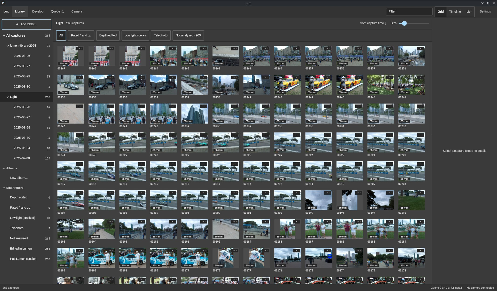
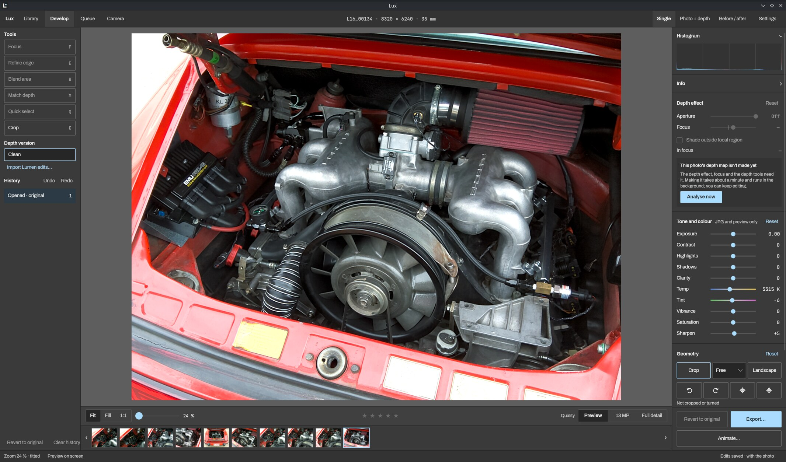
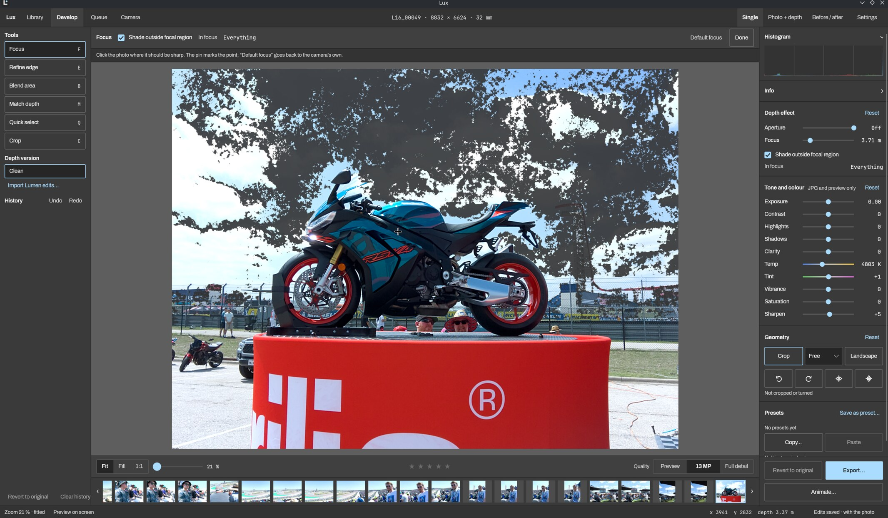
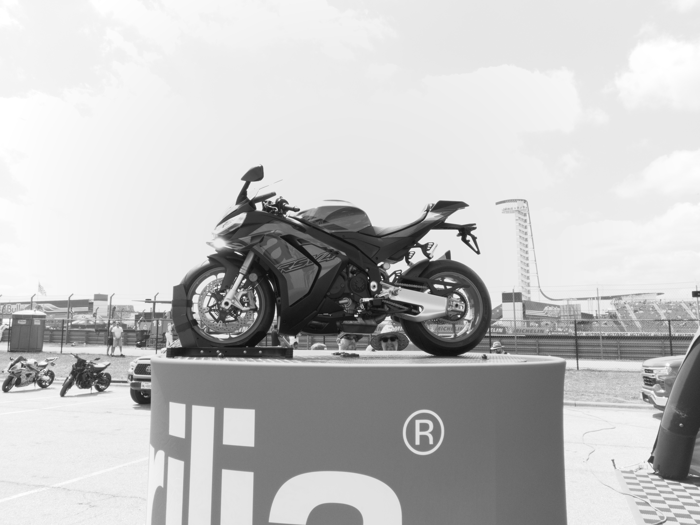
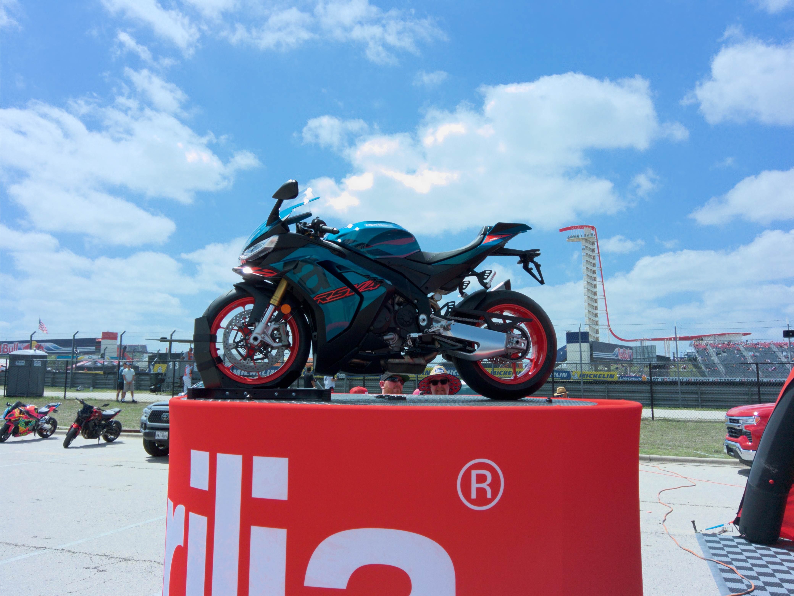
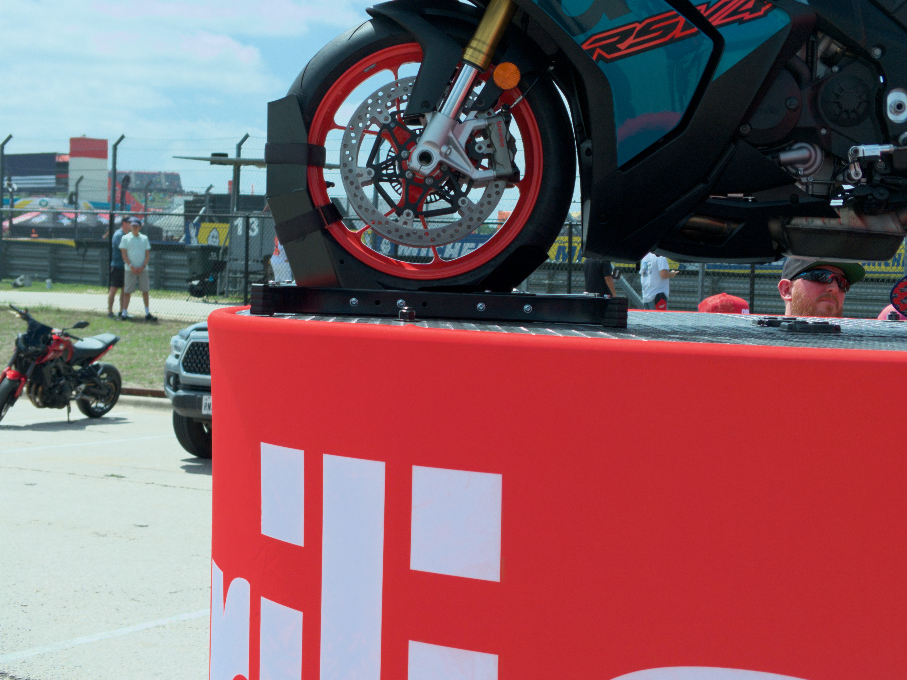
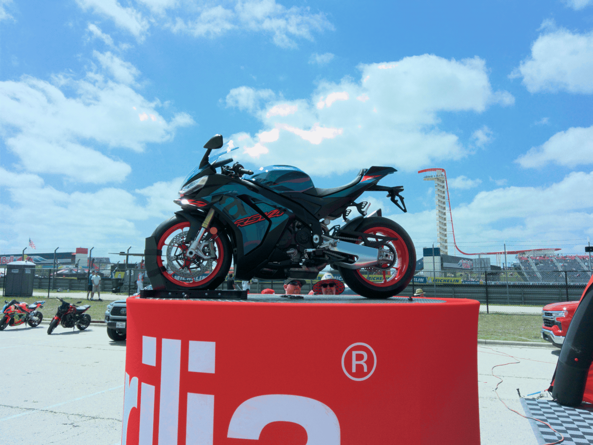
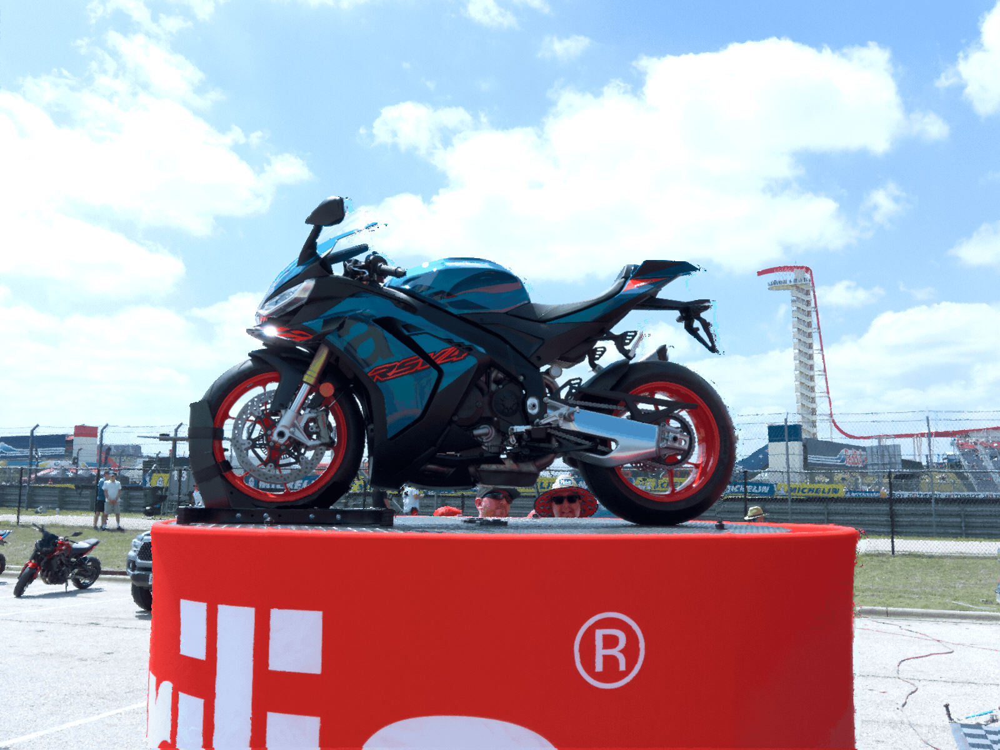

# Lux
Lux is an image processing utility for the Light L16 camera. It is independently built to be a cross-platform replacement for the original Lumen software. Its goal is to offer byte-exact processing to the original Lumen software while also adding new features and improvements.

Lux has two programs. **Lux** is the desktop app: a photo library, an editor with Lumen's depth tools, exports and camera import. **`lux-light`** is the command line tool for conversion and batch work. Both use the same engine and give the same output.

## Requirements
- [.NET 10](https://dotnet.microsoft.com/download/dotnet/10.0): The SDK to build from source. The precompiled releases bundle
  the runtime and need no .NET install.
- [ffmpeg](https://ffmpeg.org/download.html) on PATH only for AVIF animations, `--parallax-encoder ffmpeg` and MP4 / WebM video (`animate --anim-container mp4|webm`).
  - GIF, APNG and (lossless) WebP animations are written by Lux itself. The CLI exits before rendering anything if ffmpeg is needed and cannot be found.
- libgphoto2 on Linux only if MTP connection to the camera is desired

## Desktop app
The app runs on Linux, Windows and macOS (x64 and ARM64). Get it from the [Releases page](https://github.com/mprovenz/lux/releases); see [Build & run](#build--run) for the downloads.

- **Library:** add folders of captures, browse them as a grid, a timeline or a list, filter, rate, and group them in albums.
- **Develop:** tone and colour, crop and rotation, the depth effect (aperture and focus), and Lumen's depth-editing tools (refine edge, blend area, match depth, quick select). A photo and its depth map can be shown side by side, and a before / after view compares the edit with the original.
- **Quality per photo:** choose how much rendered detail Lux keeps for each photo (preview, 13 MP or full detail). Lux always keeps the depth map at full precision.
- **Export:** DNG, JPG, HDR and depth formats, and animations (rack focus, aperture sweep, wigglegram, parallax, lens tour) with a preview.
- **Lumen sessions:** import the depth edits and settings that Lumen saved for a photo.
- **Camera:** list the photos on a connected L16 and import them (Linux only for now).
- **Queue and settings:** all background work is listed in one place; thread counts, memory and the number of jobs at once are adjustable.

The library, with captures grouped by folder and day:

[](Samples/app/app-library.jpg)

One capture selected: its details, the quality choice and the actions for it.

[](Samples/app/app-library-selection.jpg)

The Develop page:

[](Samples/app/app-develop.jpg)

A photo while Lux makes its depth map and a 13 MP copy. Progress shows over the picture and in the Queue.

[](Samples/app/app-develop-processing.jpg)

The focus tool. The shaded area is outside the focal region.

[](Samples/app/app-focus-tool.jpg)

A photo beside its depth map:

[](Samples/app/app-photo-and-depth.jpg)

## Features
- .DNG and .JPG outputs 1:1 with Lumen
- MTP device connection for querying storage and pulling images (only tested on Linux right now)
- .HDR and .PPM export formats (contained in Lumen code but never used)
- GDepth and stereo depth map export support
- Individual module image export support (JPG only)
- Parallax effect animations and stills
- Full control over the image processing pipeline
- Bulk processing with multithreading
- Saved depth edits: edits to a capture's depth map are kept next to the capture and used by every export; what Lumen saved for
  a photo — its depth edits, depth effect, tone settings and crop / rotation — can be imported from its session files, after
  which Lux renders the photo as Lumen does (see [Saved depth edits](#saved-depth-edits-the-luximagecontext-folder))

## Projects
- **Lux.Engine** — the image-processing engine (`.lri` parse, module ISP, registration/depth, fusion, ResAmp,
  colour profile, DNG/JPEG/HDR output, camera pull). Its session layer (`Lux.Engine.Session`) is the one path every
  front end uses: `CaptureSession` (open a capture, render any region of any level, depth and focus queries, saved
  edits, exports, the analysis cache) and the exporter `convert` runs on.
- **Lux.Cli** — `lux-light`: `convert` (the one picture-producing verb — Lumen's DNG, JPG, HDR, PPM and
  JPEG+GDepth, plus the Lux formats that share the same render: the stereo depth pair, `lens-frames` and the
  experimental `parallax-*` animations and stills), `inspect`, `profile`, `isp`, `isp-run`, `mod-info`, `devices`,
  `pull`, `version`, `edits-info`, `import-lumen-edits`, `cache`.
- **Lux.Library** — the photo library that the app uses: folders, albums, ratings, the job queue, edit sessions and camera import.
- **Lux.App** — the desktop app (Avalonia).
- **Lux.Store** — what Lux keeps per capture on disk (the `LuxImageContext` folder): the depth-edit database and the
  analysis cache. It carries the SQLite dependency (`Microsoft.Data.Sqlite`), so the engine itself has none.

## Build & run
Precompiled builds for Linux, Windows and macOS (x64 and ARM64) are on the [Releases page](https://github.com/mprovenz/lux/releases).
Everything is self-contained, so no .NET install is needed. Pick one:

| Download | What it is |
|---|---|
| `Lux-win-Setup.exe` | Windows installer for the app (per user, no administrator rights). Includes `lux-light`. Updates itself. |
| `Lux.AppImage` | Linux app as one file: make it executable and run it. Includes `lux-light`. Updates itself. |
| `lux-<version>-<platform>` (.tar.gz / .zip) | The app and `lux-light` as a plain folder. No installer and no self-update; on Linux a `lux.desktop` file and icon are included for your launcher. |
| `lux-light-<version>-<platform>` (.tar.gz / .zip) | The command line tool alone. |

The installed builds check this repository's releases when the app starts, download a newer version in the background and apply
it only when you choose to restart. The binaries are not code-signed, so Windows shows a SmartScreen warning on first run.

ARM64: the installed builds are `Lux-win-arm64-Setup.exe` and `Lux-linux-arm64.AppImage`; the plain archives have `win-arm64` and
`linux-arm64` in their names. The Linux and Windows ARM64 builds are not yet tested on ARM64 hardware.

macOS: use the plain archives, `osx-arm64` for Apple silicon and `osx-x64` for Intel. The first archive contains `Lux.app`, with
`lux-light` in `Lux.app/Contents/MacOS`. The macOS builds do not update themselves. They are not notarised, so macOS blocks a
downloaded copy until you remove the quarantine mark:
```
tar -xzf lux-<version>-osx-arm64.tar.gz
xattr -dr com.apple.quarantine Lux.app             # for the tool alone: xattr -d com.apple.quarantine lux-light
```
```
tar -xzf lux-light-<version>-linux-x64.tar.gz      # a .zip on Windows
./lux-light convert <file-or-dir> [--out-directory out] [--formats all] [-j threads]
```
Camera import on Linux uses the system's `libgphoto2` (package `libgphoto2-6` or similar); without it the rest of Lux works.

Build from source (needs the .NET 10 SDK):
```
dotnet build Lux.slnx -c Release
./Lux.Cli/bin/Release/net10.0/lux-light convert <file-or-dir> [--out-directory out] [--formats all] [-j threads]
```
The release files are made by `packaging/pack.sh <version> <platform>` (`linux-x64`, `linux-arm64`, `win-x64`, `win-arm64`, `osx-arm64`, `osx-x64`) (it needs only the SDK; the Windows installer can be built on Linux).
The [full CLI usage instructions](#full-cli-usage-instructions) are at the bottom of this document.

Note: a full export can take a few minutes and use up to 7G of memory per file. `convert` processes inputs in parallel
with one thread per CPU by default, so on a batch pass `-j` with a count that keeps threads × 7G within your RAM.

## Status
- DNG and JPG are byte-exact to Lumen (excluding the dense-stereo race condition and assuming processed in Lumen with no pre-existing .lris). 
- Performance needs some work, exports take 2-4 minutes to process all formats
- The tool is heavily tested on Linux and checked on Windows; macOS and ARM builds are not published for now (untested)
- The desktop app is new in 2.0. Camera import in the app works on Linux only for now.

## Sample Images
All samples are one capture, `L16_00049`, written by `lux-light convert` and checked in under
[Samples/](https://github.com/mprovenz/lux/tree/main/Samples). Every image links to the full-size file on GitHub.

### Full-resolution JPG
The Lumen-identical JPG export (format `jpg`) at full size.

[](https://github.com/mprovenz/lux/blob/main/Samples/L16_00049.jpg)

### Depth map
The stereo depth map (format `depth`): the JPG half of the `<stem>_depth.f32` + `<stem>_depth.jpg` pair, on the exported grid.

[](https://github.com/mprovenz/lux/blob/main/Samples/L16_00049_depth.jpg)

### Lens frames
Every module of the capture as its own display JPG (format `lens-frames`): the five 28 mm A modules, of which A2 is the
monochrome module, and the five 70 mm B modules.

| A1 (28 mm) | A2 (28 mm, monochrome) | A3 (28 mm) | A4 (28 mm) | A5 (28 mm) |
|---|---|---|---|---|
| [](https://github.com/mprovenz/lux/blob/main/Samples/L16_00049_A1.jpg) | [](https://github.com/mprovenz/lux/blob/main/Samples/L16_00049_A2.jpg) | [](https://github.com/mprovenz/lux/blob/main/Samples/L16_00049_A3.jpg) | [](https://github.com/mprovenz/lux/blob/main/Samples/L16_00049_A4.jpg) | [](https://github.com/mprovenz/lux/blob/main/Samples/L16_00049_A5.jpg) |

| B1 (70 mm) | B2 (70 mm) | B3 (70 mm) | B4 (70 mm) | B5 (70 mm) |
|---|---|---|---|---|
| [](https://github.com/mprovenz/lux/blob/main/Samples/L16_00049_B1.jpg) | [](https://github.com/mprovenz/lux/blob/main/Samples/L16_00049_B2.jpg) | [](https://github.com/mprovenz/lux/blob/main/Samples/L16_00049_B3.jpg) | [](https://github.com/mprovenz/lux/blob/main/Samples/L16_00049_B4.jpg) | [](https://github.com/mprovenz/lux/blob/main/Samples/L16_00049_B5.jpg) |

### Parallax animations
Animated GIFs synthesised from the same capture.

#### Parallax wiggle
Format `parallax-wiggle`: the colour A-module frames, colour-matched and swept in spatial order. Module renders only, no registration.

[](https://github.com/mprovenz/lux/blob/main/Samples/L16_00049_parallax-wiggle.gif)

#### Parallax wiggle, interpolated viewpoints
Format `parallax-wiggle-interp`: virtual viewpoints along the rig's axis, synthesised from the depth, with disocclusions filled from the other real modules.

[](https://github.com/mprovenz/lux/blob/main/Samples/L16_00049_parallax-wiggle-interp.gif)

#### Parallax orbit
Format `parallax-orbit`: the same synthesis on a closed circular path.

[](https://github.com/mprovenz/lux/blob/main/Samples/L16_00049_parallax-orbit.gif)

#### Parallax single-view
Format `parallax-single`: single-view 2.5D, the sweep with no multi-view fill.

[](https://github.com/mprovenz/lux/blob/main/Samples/L16_00049_parallax-single.gif)

## Detailed image processing pipeline technical reference

A Light L16 `.lri` is a container of 10–16 independent camera frames, one per module that fired; a stacked low-light
capture carries several frames per module. Producing one image is therefore a
multi-camera fusion problem, not a single-sensor develop. The pipeline runs in five phases — **load**, **per-module
ISP**, **registration + depth**, **fusion**, **export render** — and only the last phase differs between output
formats. All formats share one `PipelineCache`; the fusion render is ~74 % of wall-clock, so producing four formats
costs barely more than one.

Verification status: DNG, JPEG, PPM and Radiance HDR are byte-identical to Lumen apart from the export timestamp;
JPEG+GDepth is byte-identical including the embedded depth map. The output does not depend on the CPU: the approximate
reciprocal and reciprocal square root that Lumen's kernels rely on (SSE `rcpps`/`rsqrtps`, whose result tables differ between
CPU vendors) are computed from a fixed table model, so an AMD host produces the same bytes as an Intel one, and the same
bytes as Lumen running on Intel hardware.

---

### 1. Container and load

#### 1.1 Container

`.lri` is a chain of `LELR` blocks: 32-byte header (magic, `u64` block length, `u64` message offset, `u32` message
length, `u8` type) followed by a protobuf message. Type 0 = `LightHeader` (merged across blocks; carries a
`CameraModule` per camera), type 1 = `ViewPreferences`, type 2 = `GPSData`. Frame data lives at
`blockBase + surface.data_offset`.

Modules are identified by `CameraID`: **A1–A5** (28 mm), **B1–B5** (70 mm), **C1–C6** (150 mm). The header's
`image_reference_camera` names the reference module, which selects several downstream branches.

#### 1.2 Surface formats

| format | layout | decode |
|---|---|---|
| `RAW_PACKED_10BPP` | 10-bit packed Bayer, 8 px per 10 bytes | bit unpack |
| `RAW_BAYER_JPEG` | `BJPG` container: header, encoder compand LUT, 256-entry `u16` dequant LUT, then baseline JPEG streams | TurboJPEG `JDCT_ISLOW`, `TJPF_GRAY`, then dequant + scatter |

The Bayer-JPEG variant is chosen by CFA: version 0 stores **four half-resolution planes, one per CFA site**
(scattered back as `dst[(2y+(p>>1))·stride + 2x + (p&1)]`), so the DCT never sees the mosaic pattern; version 1
stores **one full-resolution plane** and is used only for the monochrome module, which has no pattern to split.

#### 1.3 Stacked captures

In low light the camera writes **N frames per module** (one `CameraModule` block each, distinguished by
`frame_index`). Observed stacks are always 4 frames with identical exposure, gain, lens and mirror position.
`lt::StackFusion` merges them per module, upstream of everything else: the same 16×16 wavelet block merge used by
the inter-module fusion, with per-frame optical flow, outlier rejection, Hann-window accumulation and ÷N. Frame 0
is the reference. There is **no exposure-ratio term** — the algorithm assumes identical frames, which is what the
camera produces.

Consequence: for a stacked capture the module ISP sets `hot_pixel_removal`, `hot_pixel_leakage_removal` and
`highlight_restore` to `none`. The stack merge rejects transient outliers better than a single-frame spatial
filter can, so the dedicated stages are turned off rather than allowed to damage real detail.

#### 1.4 Load-time state

Derived once per capture and used throughout: **AsShotNeutral** (from the reference module's colour calibration at
the capture CCT/tint), **BaselineExposure** (log₂ of the gain·integration-time ratio), **`lens_shading.multiplier`**
(from CFA site histograms of the reference frame), and per-frame **black level** estimates.

---

### 2. Per-module ISP (`lt::SoftISP`)

Runs independently on each module's Bayer frame, in the Bayer domain, at a *config level* that selects resolution
and denoise strength. Stage order as executed (level 0, colour module):

| # | stage | algorithm | purpose |
|---|---|---|---|
| 1 | `HotPixelRemoval` | per-CFA-site ring/diagonal comparison against σ-tables at the frame's gain; candidate when `excess > σ[base]·k·4` | remove stuck sensor sites |
| 2 | `HighlightRestore` | reconstruct clipped channels from unclipped neighbours | recover blown highlights |
| 3 | `Placeholder` (linearize) | black subtract, normalise by `1/(white−black)`, apply WB scale | to normalised float |
| 4 | `CrossTalkCorrection` (`ir_correction`) | IR blend estimated from R/B site ratios | remove IR contamination |
| 5 | `Demosaicking` | `light_v1` (gradient-directed) at full res; `collapse2/4/8` (box-collapse) at lower levels | Bayer → RGB |
| 6 | `ColorNoiseReduction` | vec4 Gaussian/Laplacian pyramid, 5-tap `[.05 .25 .4 .25 .05]` | chroma denoise |
| 7 | `AdaptiveDesaturation` | shadow/highlight cutoff-driven saturation roll-off | tame extreme chroma |
| 8 | `Denoising` (`hybrid`) | bilateral + patch NLM over an STD plane, window 3/5/7/9 by ISO | luma denoise (off at level 0) |
| 9 | `PostProcessing` | sharpen / local contrast | detail |
| 10 | `LensShading` | calibrated per-module vignetting grid | flat field |

Branches: stages 1–2 are gated on **frames-per-stack < 2**, not on sensor colour. The monochrome module (A2,
`sensor_bayer_red_override = (-1,-1)`) never runs this ISP in Lumen — its path is the fusion one — so CFA-dependent
stages here have no defined behaviour on it.

---

### 3. Registration and depth

#### 3.1 Sparse registration

`StereoAsyncApi` builds the geometric relationship between modules:

1. **Setup** — per-camera crops, view poses, and the initial `AlignedCalib` pair from factory calibration.
2. **Feature matching**, per pyramid level, per non-reference camera:
    - top level, A-reference: `initLowerACamera<8>` — 8×8 templates, calibration- and plane-depth-guided prediction;
    - top level, B4/C5 reference: `initLowerBCamera<8>` — no calibration or plane depth, prediction is `ref − offset`,
      search is a ±`w/4` epipolar band of half-width 5, scoring is **zero-mean SAD**;
    - lower levels: `matchFeaturesPerLevelLowerCams<8>` / `…HigherCams<12>`.
      Constants: Lowe ratio 0.8, reverse ratio 0.95, score 10.0.
3. **RANSAC gate** — per-view inlier selection with distinct thresholds for the two views.
4. **Bundle adjustment** — `LightBA` over the observation set, then per-camera write-back for cameras with ≥ 26
   usable observations.
5. **Mirror-angle refinement** — coarse angular search for the movable-mirror B/C modules.

Output: per-camera `(view, module)` `AlignedCalib` pairs.

#### 3.2 Dense depth

Truncated-SAD cost volume + **semi-global matching** on the half-resolution green plane, then `DenseUpsampleLayer`
(guided upsample against a `ReferenceGuide` built from the reference frame) to a full-frame inverse-depth image
covering the whole canvas.

Note: Lumen's dense stage is **run-to-run non-deterministic** — two runs over the same capture disagree in ~1 500 of
3.2 M level-5 samples. Byte-exact comparison of a level-0 export requires pinning to the matching run.

---

### 4. Fusion

#### 4.1 Level 1 — `PackedBayerFusion`

Merges the reference-group modules onto the reference grid. 16×16 block wavelet merge: per-block optical flow
(`BlockFlow`) against the reference, CDF-style wavelet decomposition, coefficient `Shrink` driven by the sensor
noise model at the frame's gain, Hann-window accumulation, normalise by contributor count. Pyramid depth is 4
levels (5 for a C-group reference — unreachable in practice).

`MonoFusion` folds the monochrome module's luminance detail into the colour result over a 5-level wavelet pyramid.

#### 4.2 Level 0 — `ImageResolutionAmp`

Super-resolution using the higher optical group (B for an A reference, C for a B reference). Coarse alignment,
CDF 9/7 analysis, per-module preparation and warping through the dense depth (`WarpField`), merge and inverse
merge. This is the step that turns 13 MP sensors into a 52 MP output.

---

### 5. Colour

`LumenProfile` computes, per capture:

- **Illuminant entries** — every `ColorCalibration` of the reference module, with CCT/tint from its (x, y).
- **ColorMatrix 1/2** — the proto `color_matrix` of the lowest- and highest-CCT entries, verbatim.
- **ForwardMatrix 1/2** — a **refit**, not the proto value: a Ceres line-search optimisation over Lab error using
  the Macbeth reference data.
- **HueSatMap 1/2** — a 32×32×1 hue/saturation/value LUT from a thin-plate-spline fit of the same data, in linear
  ProPhoto D50.
- **Tone curve**, **AsShotNeutral**, **BaselineExposure**.

---

### 6. Export

#### 6.1 Geometry (all formats)

`setInputDataStream` establishes the canvas: `canvas = (int)(sensor · f)` snapped to the sensor's 64×48 aspect grid,
where `f` is the focal ratio of **the next optical group up over the reference group** — 70/28 = 2.5 for an
A reference, 150/70 ≈ 2.143 for a B reference. Export level 0 is `crop × canvas`, likewise snapped; the crop comes
from `ViewPreferences`. Five levels are built, each a halving.

`GetExportTransformOutput` then resolves a requested output size to a source level, a source rect and a scale. When
`scale > 1.5` the resampler is a separable **Lanczos-2 blur followed by bilinear warp**; otherwise it is a 64-phase
**Catmull-Rom** (`ImageWarpClamped<2>`).

#### 6.2 Per-format paths

The output ISP is gated on `(fmt | 4) == 4`, i.e. **only JPEG and JPEG+GDepth re-run it**. Formats 1, 2 and 3 take
the float render directly.

| fmt | output | path |
|---|---|---|
| 0 | JPEG | output ISP → 8-bit → libjpeg-turbo baseline, quality 98, 4:2:0, standard Huffman tables, Exif + `LibCP` comment |
| 1 | PPM | float → `×255`, `cvtps2dq` (round-half-to-even), saturate → `P6` header + flat RGB |
| 2 | DNG | float tiles → vignetting removal → resample → `×16384` → lossless JPEG (SOF3, predictor 1) tiles → DNG container |
| 3 | Radiance HDR | float → RGBE, flat uncompressed, `#?RADIANCE` header; **scene-linear camera raw**, not display-referred |
| 4 | JPEG + GDepth | fmt 0, plus the depth map as XMP |

#### 6.3 Output (display) ISP — formats 0 and 4 only

Runs in the Color domain on the fused tile, with a constant halo of 64:

| slot | stage | algorithm |
|---|---|---|
| 2 | ÷ neutral | divide by AsShotNeutral |
| 10 | `ColorCorrection` (`optimized`) | matrix + CCT-interpolated HSV LUT, 33×33 bilinear hue/sat, in linear ProPhoto D50, gamut clip |
| 11 | `PostProcessing` | saturation and vibrance (in Lab, hue-dependent), sharpen or soften |
| 12 | `LensShading` (`inverse`) | re-apply shading model inverted |
| 13 | `ToneAdjust` (`laplacian_pyramid`) | local Laplacian tone adjustment |
| 14 | `ContrastAdjust` | `0.217·(x/0.217)^(2^(0.3a))` via fast log2/exp2 |
| 15 | `ToneMapping` | ACR-family LUT + `RGBTone` hue preservation, then ProPhoto → sRGB |

The tone-mapping variant (`light_v1` / `light_v2` / `acr`) is selected by a renderer flag that differs between the
GUI and a headless render; both branches are implemented.

#### 6.4 Colour-space property

The application sets export property `0x13` from the format: `fmt ≤ 1 → 4 (sRGB)`, `fmt == 2 → 0 (none)`,
`fmt == 3 → 1 (linear sRGB)`, anything else throws — which is why format 4 is unreachable from Lumen's UI. A DNG
therefore carries `ColorSpace = 65535` and no Interop IFD; a JPEG carries `ColorSpace = 1`. For formats 1–3 the
property is **inert**: those paths never read the output tuning.

#### 6.5 GDepth (format 4)

The depth map comes from a dedicated double-buffered depth image cache at **pipeline level 1**, holding
`InverseDepthClip(ImageResample<0>(InverseDepth(fullDepth)), 100000)` — metric millimetres, resampled nearest in
inverse-depth space, clipped at 100 m. It is warped to the export grid by the same transform as the colour image,
scanned for `Near`/`Far`, quantised to 8-bit by

```
E = recip(d·(far − near)) · (d − near) · (255·far)
```

encoded as a grayscale JPEG, base64'd into `GDepth:Data`, and split across extended-XMP APP1 chunks of 65 458 bytes.
`Far` is always the 100 m clip constant, not a scene value, so the top of the range is coarsely quantised.

Inverse mapping, for consumers: `d = far·near / (far − u·(far − near))` with `u = E/255`.

---

### 7. Modification options

| option | effect |
|---|---|
| export size / level | selects the source level and resampler via `GetExportTransformOutput` |
| crop | from `ViewPreferences`; sets export level 0 relative to the canvas |
| rotation | baked into the transform; `Orientation` stays 1 |
| tone mapping type | `acr` / `light_v1` / `light_v1_lowlight` / `light_v2` |
| compression | DNG: uncompressed strips or lossless JPEG tiles |
| colour space | property `0x13`; only consumed on the JPEG path |
| exposure / f-number / ISO / focal | Exif values; `AllInFocusFNumber` is computed as `aperture · equiv35 / physical` |
| tone & colour | the editor's sliders (exposure, contrast, temperature, tint, vibrance, saturation, sharpening) and shadows / highlights / clarity, each mapped onto the output-ISP stage it drives (§6.3); JPEG path only |


## Where Lux keeps a photo's data

Everything Lux saves about a photo — your depth edits, saved settings, rating, and the analysis that makes later opens and exports
fast — is kept **next to the photo**, in a folder named `LuxImageContext` (described below), so it travels with your captures and
survives renaming them. When Lux cannot write next to a photo — a read-only drive, a card with the lock switch on, a shared folder you
may only read — it keeps the same files **on this computer** instead, in a folder of the desktop app's data (by default
`~/.local/share/Lux/contexts` on Linux, `%APPDATA%\Lux\contexts` on Windows; you can choose another folder in the app's settings, and
its contents move with it). Nothing is lost and nothing has to be done: as soon as the photo's folder can be written again (the drive
is mounted read-write, the permission is fixed), the app moves the data next to the photo by itself, checking every byte before it
removes its own copy. If the photo's folder meanwhile got data of its own (for example, the same drive was edited on another computer),
the data next to the photo is kept and Lux's local copy is set aside, not deleted, so it can still be recovered. `lux-light` reads
both places, so a `convert` honours edits the app saved for photos on read-only drives (set `LUX_APP_DATA` or `LUX_CONTEXT_STORE` if
the app's data is not in the default place); like before, `convert` itself never creates any of these folders. To find the app's local
folder, `lux-light` reads one small file the app keeps beside its library, `context-store-folder.txt` (written when the app opens its
library and whenever you change the folder). If that file is missing (a library the current app has not opened yet), it reads the one
setting from the library database in SQLite's read-only "immutable" mode. Either way `lux-light` writes nothing in the app's folder: no
`-shm` / `-wal` files and no changed file times.

For testing and portable set-ups: `LUX_APP_DATA` moves the app's whole data folder, and `LUX_FORBID_DEFAULT_APP_DATA=1` makes any program
of the suite stop with an error instead of using the per-user folder (the test tools set both, so a test can never reach your own
library).

## Saved depth edits (the `LuxImageContext` folder)

Lux keeps what it knows about a capture beyond the `.lri` itself in a folder named **`LuxImageContext`**, next to the captures:

```
<folder with your .lri files>/
  LuxImageContext/
    edits/    one file per edited capture (<long hexadecimal name>.luxedits) — your depth edits. Keep this folder.
    cache/    data Lux can compute again at any time. Safe to delete.
```

- **`edits/` is your work.** It holds every depth edit you made, losslessly, together with the depth map the edits were made on
  and the list of editing steps. No clean-up in Lux removes it. Back it up with the captures; if you move captures to another
  folder, move the `LuxImageContext` folder with them.
- **Files are matched by content, not by name.** The name of each `.luxedits` file is a fingerprint (SHA-256) of the capture
  file's content. Renaming a `.lri` does not lose its edits, and a different capture that happens to get an old file's name does
  not pick up edits that are not its own.
- **Nothing is created until there is something to save.** A plain `convert` never creates the folder, and a capture without saved
  edits converts exactly as before.
- **Variants.** One capture can hold more than one set of edits, called variants, and exactly one of them (or none) is active:
  - `lux` — edits made in Lux. They start from Lux's own depth map and keep the full list of steps, so undo works across
    sessions.
  - `lumen-import` — a Lumen session file brought over with `lux-light import-lumen-edits`: its depth edits (if it has any)
    together with the photo's settings from Lumen (see below).

  Switching the active variant (`lux-light edits-info <lri> --set-active <variant>`) never deletes the others, and
  `--set-active none` / `convert --no-edits` always give the clean, unedited picture.
- **Edits are checked when they are loaded.** Every stored block carries a checksum. `lux-light edits-info <lri>` lists what is
  stored and reports any block that is damaged. If the saved list of editing steps can no longer reproduce the saved result (for
  example after damage), the saved result is kept as it is and only undo into earlier sessions is switched off.

**What an import brings over from Lumen.** Lumen keeps a session file (`.lris`) next to every photo you opened or exported. When
it reopens a photo it does not work the picture out again from the `.lri`: it restores it from that file. `import-lumen-edits`
brings everything that file holds into the photo's `LuxImageContext`, so that `lux-light convert` — with no options — produces
the picture Lumen produces after reopening the session:

- the depth map Lumen stored and the camera geometry it had worked out (the picture is assembled with them, exactly as Lumen does);
- the depth edits made with Lumen's depth tools, if there are any;
- the depth effect: the aperture (f-number) and the focus distance you set;
- the tone and colour settings: exposure, white balance (temperature and tint), contrast, saturation, vibrance and sharpening
  (they affect the JPG; a DNG carries the unprocessed image, as from Lumen);
- crop and rotation, and the full-size output size Lumen uses for them;
- the star rating (shown by `edits-info`; it does not change the picture).

Any option you give to `convert` replaces just that setting (for example `--f-number 4` keeps the saved focus, tone and crop);
`--no-edits` ignores everything saved. Photos without a `LuxImageContext` folder are converted exactly as before.

One thing Lumen does not write into the session file: the tone rendering its own window used when it exported. Lumen 2.3 as
it ran in 2025 exported with its "v2" tone curve; to reproduce those DNG and JPG files byte for byte add
`--jpeg-v2 --dng-tone light_v2` to `convert`.

> **About edits imported from Lumen.** Edits imported from Lumen use the depth map Lumen stored in its session file. That depth
> map is slightly less precise than the one Lux computes (Lumen stores it in a compact, rounded form), so results are lower
> fidelity than editing again from a clean Lux start. In return, the imported variant renders exactly as Lumen does after
> reopening that session. The clean Lux depth is still there: `--no-edits` renders without any edits or saved settings, and a
> clean `lux` variant can be started beside the imported one at any time.

Example:

```
lux-light import-lumen-edits ~/Pictures/L16            # every .lris whose .lri is beside it
lux-light edits-info ~/Pictures/L16/L16_00493.lri      # what is saved, which variant is active, is it intact
lux-light convert ~/Pictures/L16/L16_00493.lri         # the photo as Lumen shows it: edits, depth effect, tone, crop
lux-light convert ~/Pictures/L16/L16_00493.lri --f-number 2             # the same with another aperture
lux-light convert ~/Pictures/L16/L16_00493.lri --no-edits               # the clean picture, nothing saved applied
```

## The analysis cache (`LuxImageContext/cache`)

Most of the time of a full-size export goes into work that only depends on the capture: working out the exact geometry of the
sixteen cameras and the depth map (the registration — about half of a full-size export), fusing the modules into the 13 MP
image, and building the full-size image. Lux can keep the results in the capture's `LuxImageContext/cache/` folder, so that
the next export, preview or edit of that capture starts from them. **The cache only ever saves time: an export from a cached
capture is byte-identical to one computed from scratch**, because what is kept is the pipeline's own intermediate data,
stored losslessly.

A capture's cache has a level, and each level includes the ones before it:

| Level | What is kept | What it saves | Size (typical, compressed) |
|---|---|---|---|
| `geometry` | the camera geometry and the full-resolution depth map | the registration, in every later export; anything that reads the depth (depth effect, `jpg+depth`, `depth`) | 14–17 MB |
| `13mp` | also the 13 MP linear image and the previews (levels 2–4) | the fusion: 13 MP exports and previews run only the output stage | +49–57 MB |
| `full` | also the full-size linear image under the export window | everything but the output stage of a full-size export (about 10 s instead of 1–2 min) | +180–205 MB |

```
lux-light cache ~/Pictures/L16/L16_00493.lri                  # what is kept, and how big it is
lux-light cache ~/Pictures/L16/L16_00493.lri --level 13mp     # raise it (computes what is missing)
lux-light cache ~/Pictures/L16 --level geometry              # a whole folder
lux-light cache ~/Pictures/L16/L16_00493.lri --level none     # remove it
```

- **Keyed by content and by engine version.** The cache file is named by the capture's SHA-256, like the edits, and records
  the version of the engine's cache format. A cache written by another version is discarded and rebuilt, never used.
- **Checked on every read.** Every stored block carries a checksum of its data. A damaged block is never used: it is
  recomputed for the export at hand, and its tier is marked incomplete (`cache` shows it, `cache --level` rebuilds it).
- **Safe to delete at any time** — Lux recomputes whatever is missing. Nothing is ever removed automatically.
- **`convert` uses whatever a capture's cache holds.** When the capture already has a `LuxImageContext` folder (made by the
  `cache` command, by saved edits or by the desktop app), `convert` also keeps the geometry and depth it computed, so the next
  export skips the registration. `convert` never creates that folder by itself; `--no-cache` turns the cache off for a run.
- **Memory.** A full-size export peaks at about 5.5–8 GB (about 3 GB from a `full` cache). `--memory-budget <GB>` trades time for
  memory with the same output: on a wide capture 4 GB took +25 % time and 3 GB +80 %; a stacked (night) capture does not go below
  about 5 GB (+50 % time at a 4 GB budget).

## Full CLI usage instructions
### USAGE

```
lux-light <command> [options] [input...]
lux-light --help
```

### COMMANDS

| Option | Description |
|---|---|
| `convert <input...>` | Process a .lri and export it exactly as Lumen does: the image pipeline run once, written out in any combination of export formats (see below). Everything comes from the .lri, and no option changes the Lumen pixels unless you pass one from ADJUSTMENTS; --level/--size/--origin only pick the output grid. |
| `inspect <input...>` | Print the load-time state derived (neutral, ev, multiplier) |
| `mod-info <input...>` | Per-module CameraID, gain, exposure, frame black, relative_brightness |
| `profile <input...>` | compute and print the colour profile (matrix fit, ForwardMatrix, HueSatMap) |
| `isp <input...>` | Module-ISP tuning per config level, stage list, white-balance state |
| `isp-run <input...>` | Run the module ISP over a centre ROI, write a gamma-encoded PPM |
| `devices` | List connected MTP cameras |
| `pull [options]` | Pull matching files off the camera |
| `version [--offline]` | Print this build's version and check GitHub for a newer release |
| `edits-info <input...>` | Show a capture's saved depth edits: the variants, which one is active, how much is stored, and whether everything stored is intact. `--set-active <variant\|none>` chooses the variant `convert` uses |
| `import-lumen-edits <lris file or folder...>` | Bring Lumen session files (.lris) into Lux: the depth map and edits, the depth effect, tone and colour settings, crop / rotation and rating Lumen saved for each photo. Each session's capture (the .lri of the same name) must sit beside it |
| `animate <input...> --anim-effect <effect>` | An animation of each capture, as the desktop app makes them: `rack-focus` and `aperture-sweep` (Lumen's depth effect — each frame is exactly the still `convert --f-number … --focus-depth …` writes), `wigglegram` (the wide lenses' own pictures), `parallax` (a small camera move drawn from the photo and its depth), `lens-tour` (every lens in turn). GIF, APNG and WebP are Lux's own writers; MP4 / WebM need ffmpeg. Options: `lux-light --help`, ANIMATE OPTIONS |
| `cache <input...> [--level none\|geometry\|13mp\|full]` | Show a capture's analysis cache, or raise / lower it to a level (see [The analysis cache](#the-analysis-cache-luximagecontextcache)). Exports from the cache are byte-identical to exports computed from scratch |

### INPUT

convert, animate, inspect, mod-info, profile, isp, isp-run, edits-info and cache take one or more .lri files and/or directories (directories are scanned for *.lri). import-lumen-edits takes .lris files and/or directories. devices, pull and version take no input files.

### CONVERT OPTIONS

With no options specified, `convert` replicates Lumen output exactly: DNG (fmt 2) + companion JPG (fmt 0), full size, every value processed from the .lri. The flags marked * depart from that, and the run echoes which were applied.

#### OUTPUT

| Option | Description |
|---|---|
| `-o, --out-directory <dir>` | Write `<stem>.<ext>` per input (default: a lux_convert/ beside the .lri) |
| `--out-file <path>` | Name the output file (only when the run makes exactly one file) |
| `-j, --threads <n>` | Inputs converted in parallel (default: CPU count) |
| `--render-threads <n>` | Threads per input for the tile render (default: CPU count ÷ the inputs converted at once; 1 = sequential) |
| `--formats <list>` | Original (extended): dng, jpg, hdr, ppm, jpg+depth<br>New:   depth, lens-frames, parallax-wiggle, parallax-wiggle-interp, parallax-orbit, parallax-single, parallax-rack, parallax-dolly, parallax-dof, parallax-anaglyph, parallax-crosseye, parallax-sbs, parallax-still<br>all:   every format above except hdr and ppm<br>Comma-separated (default dng,jpg)<br>`depth` is the metric-millimetre stereo pair (`<stem>_depth.f32` + `<stem>_depth.jpg`) on the exported grid. The Lux formats are named `<stem>_<format>.<ext>`; lens-frames writes `<stem>_<module>.jpg`. |

#### GRID (picks the pixel grid; leaves tone and colour alone)

| Option | Description |
|---|---|
| `--level <n>` | export level, 0 = full size (default) |
| `--size <w,h>` | explicit output size (default: the level's export window) |
| `--origin <x,y>` | level-0 export window origin |

#### SHARED ADJUSTMENTS

| | Option | Description |
|---|---|---|
| \* | `--rotate <90\|180\|270>` | bake the orientation (Orientation stays 1). All four raster formats; a depth map written alongside them follows the same rotation. Not combinable with the parallax formats (their rig geometry is in the unrotated frame) |
| \* | `--transform <m;c>` | a crop / turn / flip exactly as Lux and Lumen save it: the nine matrix values, `;`, the crop corners x0,y0,x1,y1 (decimal, or 0x + the float's 32-bit pattern); the size follows Lumen's full-size rule. All four raster formats; not combinable with `--rotate` or the parallax formats |
| \* | `--upright` | turn a photo the way the camera was held (from its accelerometer) with Lumen's own rotate — as the desktop app exports it by default. Only when the photo's crop / rotation was never edited (a saved one is followed anyway). Without it, `convert` writes the capture as recorded, exactly as Lumen does (Lumen never turns a photo by itself). All four raster formats; not combinable with `--rotate`, `--transform` or the parallax formats. `animate --upright` turns its frames the same way |
| \* | `--fnum <f>` | Exif FNumber [dng, jpg, jpg+depth] |
| \* | `--iso <n>` | Exif ISO [dng, jpg, jpg+depth] |
| \* | `--focal <n>` | Exif focal length in mm [dng, jpg, jpg+depth] |

#### DEPTH EFFECT

Lumen's synthetic depth of field, for dng, jpg, jpg+depth, hdr and ppm.

| | Option | Description |
|---|---|---|
| \* | `--f-number <N>` | blur the picture as a lens of aperture f/N would, using the capture's depth map: the smaller N, the shallower the depth of field. Values at or above the capture's own all-in-focus f-number (about f/15 for a 28 mm capture) leave the image unchanged, exactly as in Lumen, whose slider runs from f/4 up to that value; smaller values are accepted. The Exif FNumber becomes N. Needs the depth map, so the full registration runs even at a reduced `--level` |
| \* | `--focus-depth <mm>` | distance that stays sharp, in millimetres (default: the distance the camera focused at, as Lumen chooses it). Needs `--f-number` |
| \* | `--focus-point <x,y>` | focus on whatever is at this point of the picture instead, like clicking with Lumen's focus tool: x and y from 0 to 1, 0,0 = top left. Needs `--f-number`; not combinable with `--focus-depth` or `--rotate` |

#### TONE & COLOUR ADJUSTMENTS

The controls of Lumen's editor. They change how the picture is rendered and affect the jpg and jpg+depth images (and the
on-screen preview) only; a DNG, PPM or HDR keeps the image as it is before this rendering and is written exactly as without them.
A control left out keeps the picture as Lumen renders it; with none of them the output is unchanged to the byte. Lux renders a
slider setting exactly as Lumen does, pixel for pixel.

| | Option | Description |
|---|---|---|
| \* | `--exposure <stops>` | brighter (+) or darker (−), −3 to 3 stops |
| \* | `--contrast <v>` | more (+) or less (−) contrast, −100 to 100 |
| \* | `--temperature <K>` | white balance: colour temperature in kelvin, 2000 to 20000 (default: as shot); lower values make the picture bluer, higher warmer |
| \* | `--tint <v>` | white balance: green (−) to magenta (+), −150 to 150 (default: as shot) |
| \* | `--vibrance <v>` | strengthen (+) or mute (−) colours, the duller ones most, sparing skin tones, −100 to 100 |
| \* | `--saturation <v>` | strengthen (+) or weaken (−) all colours, −100 (black and white) to 100 |
| \* | `--sharpening <v>` | sharpen (+) or soften (−), −100 to 100 (default 5, Lumen's own setting); the same control as `--jpeg-sharpening`, give one of the two |
| \* | `--shadows <v>` | lift (+) or deepen (−) the shadows, −100 to 100 |
| \* | `--highlights <v>` | recover (+) or brighten (−) the highlights, −100 to 100 |
| \* | `--clarity <v>` | more (+) or less (−) local contrast in the midtones, −100 to 100 |

`--shadows`, `--highlights` and `--clarity` are Lux controls: the processing is part of Lumen's software, which never offered it
as controls.

#### SAVED DEPTH EDITS

A capture whose depth map was edited keeps those edits in the `LuxImageContext` folder next to it (see
[Saved depth edits](#saved-depth-edits-the-luximagecontext-folder)). Wherever `convert` reads the depth — `--f-number`,
`jpg+depth`, `depth`, the depth-based parallax formats — it uses the edited depth of the capture's active variant and says so
in its output. A variant imported from a Lumen session also carries that photo's settings (depth effect, tone and colour,
crop / rotation): `convert` then renders the photo as Lumen does after reopening the session, and each option you give replaces
only its own setting. Captures without saved edits are not affected in any way.

| | Option | Description |
|---|---|---|
| \* | `--no-edits` | ignore saved depth edits and saved settings: use the depth computed from the capture |
| \* | `--edits <variant>` | use this variant instead of the active one (`edits-info` lists them) |

#### ANALYSIS CACHE

Whatever a capture's analysis cache holds replaces the work that would produce it; the output is byte-identical either way (see
[The analysis cache](#the-analysis-cache-luximagecontextcache)). When the capture already has a `LuxImageContext` folder, convert
also keeps the geometry and depth it computed there.

| | Option | Description |
|---|---|---|
| | `--no-cache` | neither read nor write the analysis cache |
| | `--memory-budget <GB>` | keep a full-size render within about this much memory (default: no limit, the fastest); the same output, more time |

#### DNG

| | Option | Description |
|---|---|---|
| \* | `--dng-cs <n>` | colour-space property 0x13 (default 0 = none, the app path) |
| \* | `--dng-tone <profile>` | acr \| light_v1 \| light_v1_lowlight \| light_v2 |
| \* | `--dng-comp <0\|1>` | 0 uncompressed, 1 lossless JPEG (default) |

#### JPEG

(each of these also applies to jpg+depth)

| | Option | Description |
|---|---|---|
| \* | `--jpeg-cs <n>` | colour-space property 0x13 (default 4 = srgb) |
| \* | `--jpeg-quality <n>` | libjpeg quality (default 98) |
| \* | `--jpeg-sub <0\|1\|2>` | chroma subsampling (default 2 = 4:2:0) |
| \* | `--jpeg-v2` | the renderer+0x64 v2 tone-mapping gate |
| \* | `--jpeg-sharpening <v>` | the renderer's sharpening property (ParamFloat 13, -100..100; default 5 = Lumen's export state); the same control as `--sharpening` |
| \* | `--jpeg-modify <ts>` | Exif 0x0132 ModifyDate, YYYY-MM-DDTHH:MM:SS (default: now) |
| \* | `--jpeg-comment <s>` | the JPEG COM marker text |
| \* | `--jpeg-software <s>` | the Exif Software string |

#### HDR

| | Option | Description |
|---|---|---|
| \* | `--hdr-cs <n>` | colour-space property 0x13 (default 1 = linear_srgb) |

#### PPM

*(no options)*

#### DEPTH

*(no options)*

#### LENS-FRAMES

(Each module of the capture as a display JPG through the ported module ISP. A STACKED capture has several frames per module: `all` writes every one as `<stem>_f<k>_<module>.jpg`, an index picks one, and the default is frame 0, the frame Lumen's StackFusion references.)

| Option | Description |
|---|---|
| `--lens-quality <n>` | JPEG quality 1-100 (default 92) |
| `--lens-ev <float>` | exposure adjust in stops (default 0.95) |
| `--lens-level <n>` | module-ISP config level (default 0 = full-res, no denoise) |
| `--lens-profile <p>` | CIAPI RendererProfile 0-3 (default 3 = Desktop) |
| `--lens-modules <list>` | comma-separated module filter, e.g. A1,B4 |
| `--lens-stack <all\|n>` | which frame of a stacked capture (default 0) |

#### PARALLAX

(EXPERIMENTAL: The base imagery is the pipeline's module-ISP frames, or this run's JPEG render and its metric depth. Only the 28 mm A array is a multi-view rig; a telephoto capture has no A modules, so parallax-wiggle refuses it and the depth formats run single-view.)

| Option | Description |
|---|---|
| `parallax-wiggle` | A-group frames, colour-matched, swept in spatial order. Module renders only, no registration |
| `parallax-wiggle-interp` | N virtual viewpoints along the rig's axis, synthesised from the depth, disocclusions filled from the other real modules |
| `parallax-orbit` | the same synthesis on a closed circular path |
| `parallax-single` | single-view 2.5D: the sweep with no multi-view fill |
| `parallax-rack` | animated rack focus with the experimental layered blur (`animate --anim-effect rack-focus` uses Lumen's depth effect) |
| `parallax-dolly` | dolly zoom, pulling back while zooming in |
| `parallax-dof` | synthetic depth of field, one PNG still |
| `parallax-anaglyph` | red/cyan (Dubois) anaglyph of a synthesised stereo pair, PNG |
| `parallax-crosseye` | cross-eye side-by-side stereo pair, PNG |
| `parallax-sbs` | parallel-view side-by-side stereo pair, PNG |
| `parallax-still` | one synthesised viewpoint, PNG |

Every format but parallax-wiggle forces the level-0 build (announced, as jpg+depth is) and synthesises from this run's JPEG render at --level, downscaled to --parallax-size: --level 2 renders the base at 2608 px, plenty for a 1600 px animation and far faster than full size.

| Option | Description |
|---|---|
| `--parallax-format <c>` | animation container: gif (default) \| webp \| avif \| apng. GIF, APNG and WebP are Lux's own writers; AVIF goes through ffmpeg. **WebP is now lossless by default** (every pixel exact), so it is several times larger than the earlier lossy WebP — 46 frames at 800 px came to 14.7 MB; add `--parallax-encoder ffmpeg` for the old lossy WebP (`--parallax-quality` sets its quality) |
| `--parallax-encoder <e>` | lux (default) \| ffmpeg: the earlier ffmpeg recipes for every container (one GIF palette with Bayer dithering, lossy WebP) |
| `--parallax-size <n>` | long edge of the working image in px (default 1600; 0 = native, for parallax-wiggle) |
| `--parallax-ms <n>` | per-frame duration in ms (default 100 for parallax-wiggle, 70 for -rack and -dolly, 60 otherwise) |
| `--parallax-frames <n>` | virtual viewpoints / animation frames (default 24) |
| `--parallax-loop <k>` | pingpong (default) \| forward (the orbit is closed and plays forward) |
| `--parallax-fill <k>` | donors (default: disocclusions from the other real A modules, then inpaint) \| inpaint \| none (holes left black, to see where they are) |
| `--parallax-path <k>` | sweep (default, along the rig's dominant axis, 12 deg off horizontal from the factory extrinsics) \| arc \| line, for parallax-wiggle-interp and -single |
| `--parallax-baseline <mm>` | peak-to-peak path extent (default 71.49, the widest physical colour baseline A4-A5; usable to about twice that) |
| `--parallax-converge <k>` | convergence plane: auto (default, the median depth) \| none \| metres. Everything at that depth stays fixed and the scene swings around it |
| `--parallax-converge-at <x,y>` | read the convergence depth off the depth map at that pixel of the working image instead |
| `--parallax-ipd <mm>` | stereo interocular distance (default 25 for the anaglyph, 63 for the side-by-side pairs; 63 with a near foreground is hard to view) |
| `--parallax-anaglyph <k>` | dubois (default, least-squares de-ghosting) \| colour \| grey |
| `--parallax-focus <m>` | parallax-dof focus distance in metres (default: the 10th-percentile depth) |
| `--parallax-focus-at <x,y>` | read the focus depth off the depth map at that pixel instead |
| `--parallax-aperture <mm>` | aperture DIAMETER for -dof and -rack (default 20 = f/1.4 on the A group's 28 mm equivalent) |
| `--parallax-layers <n>` | depth layers in the composite (default 8) |
| `--parallax-rack <m1,m2>` | rack the focus from m1 to m2 metres (default: the 10th- to the 90th-percentile depth) |
| `--parallax-rack-at <x1,y1;x2,y2>` | rack between the depths at two pixels instead |
| `--parallax-subject <m>` | parallax-dolly: the depth held constant, metres (default: the 10th percentile) |
| `--parallax-subject-at <x,y>` | read it off the depth map at that pixel instead |
| `--parallax-dz <mm>` | dolly travel (default 400; positive pulls back and zooms in, the one direction a single capture can carry — negative is clamped) |
| `--parallax-t <tx,ty>` | parallax-still: the virtual camera translation in mm (default 40,0) |
| `--parallax-quality <n>` | ffmpeg's lossy WebP quality (default 88) [--parallax-format webp --parallax-encoder ffmpeg] |
| `--parallax-crf <n>` | AVIF encoder crf (default 18) [--parallax-format avif] |
| `--parallax-order <k>` | parallax-wiggle frame order: sweep (default, along the rig's dominant axis from the factory extrinsics) \| label (module-name order) \| an explicit list, e.g. A5,A1,A3,A4 |
| `--parallax-pivot <x,y,w,h>` | parallax-wiggle: hold a region still so the scene swings around it; integer shift only, no resampling. Native sensor pixels |

### INSPECT OPTIONS

*(none — inspect takes only input paths)*

### MOD-INFO OPTIONS

*(none — mod-info takes only input paths)*

### PROFILE OPTIONS

*(none — profile takes only input paths)*

### ISP OPTIONS

| Option | Description |
|---|---|
| `--isp-level <n>` | module-ISP config level (default 0; -1 prints every level 0-5) |
| `--profile <p>` | CIAPI RendererProfile 0-3 (default 3 = Desktop) |

### ISP-RUN OPTIONS

| Option | Description |
|---|---|
| `--isp-level <n>` | module-ISP config level (default 0) |
| `--profile <p>` | CIAPI RendererProfile 0-3 (default 3 = Desktop) |

*(the PPM is written beside the .lri as `<stem>_isp_l<n>.ppm`)*

### DEVICES OPTIONS

*(none)* — each camera is listed with its port, its name, serial number and battery level, and its storage areas; a camera another
program holds (often the desktop's file manager) is listed with that reason.

### PULL OPTIONS

| Option | Description |
|---|---|
| `-o, --out-directory <dir>` | file destination (default: ./lux_pull) |
| `--ext <list>` | extensions to include (default .lri) |
| `--glob <pattern>` | filename glob, e.g. "L16_004*" |
| `--since <date>` | only files modified on/after this date |
| `--overwrite` | re-download even if a same-size file exists locally |
| `--list` | list matching files without downloading |

*(the camera's calibration files in `lightcal/` are not captures and are never pulled)*

The camera is only read. Each file is written to `<name>.part` and renamed when it is complete; a file that fails or is interrupted leaves
nothing behind. Files already present with the same size are skipped, and the files still to copy must fit on the destination drive (with
256 MB to spare) before anything is copied.

### EDITS-INFO OPTIONS

| Option | Description |
|---|---|
| `--set-active <variant>` | make this variant the one `convert` uses; `none` = no variant, the capture renders without edits (nothing is deleted) |

Exit status: 0 everything stored is intact (or the capture has no saved edits), 1 a stored block failed its check or the database could not be opened.

### IMPORT-LUMEN-EDITS

`lux-light import-lumen-edits <lris file or folder...>` takes no options. For every session file that has its capture beside it, what Lumen saved for the photo — its depth map and camera geometry, the depth edits if any, the f-number and focus, the tone and colour settings, crop / rotation and rating — is stored as the variant `lumen-import` of that capture and made active; `convert` then renders the photo as Lumen does after reopening the session (see [Saved depth edits](#saved-depth-edits-the-luximagecontext-folder)). A session is refused when Lumen itself could not load it for that capture (it belongs to another photo) or when it holds no depth map. Importing the same session twice does nothing; a session whose depth edits were imported by an earlier Lux gets its settings added.

### VERSION OPTIONS

| Option | Description |
|---|---|
| `--offline` | print the version only, without asking GitHub |

Exit status: 0 up to date (or no release published yet), 1 a newer release is available, 2 the check could not be made (no network, GitHub error). The release page is https://github.com/mprovenz/lux/releases.

### GLOBAL OPTIONS

| Option | Description |
|---|---|
| `-h, --help` | this help |

### ENVIRONMENT VARIABLES

\* For diagnostic / development use only

#### LOGGING

| Option | Description |
|---|---|
| `LUX_VERBOSE=1` | convert: per-file progress detail, and the full exception trace when a file fails instead of just its message |
| `LUX_NO_PROGRESS=1` | convert: no in-place progress lines (they are also off when stderr is not a terminal or LUX_VERBOSE=1 is set) |
| `LUX_PROGRESS_TRACE=1` | convert: print every progress update as a line (phase, done/total) — for debugging the phase flow |

#### BEHAVIOUR — these change what the pipeline computes

| Option | Description |
|---|---|
| `LUX_CC_FM=<fm1;fm2>` | replace the fitted ForwardMatrix1/ForwardMatrix2 in colour correction with two space-separated 9-float matrices |
| `LUX_CC_M=<m>` | replace the camera→working matrix outright (9 floats, or 0x-prefixed bit patterns), bypassing the fit and the CCT interpolation |
| `LUX_CNR_NEUTRAL=r,g,b` | colour-noise reduction uses this neutral instead of the ISP stats' |
| `LUX_CNR_NOEXT=1` | colour-noise reduction reads no pixels outside its own region (drops the ±2-pixel ring) |
| `LUX_FRAME_BLACK=<f>` | linearize uses this black level instead of the stats'/frame's |
| `LUX_FUSION_SRC_BLACK=db\|estimate` | the black level for the fusion's non-reference source frames: db = the sensor database value, estimate = the per-frame estimate |
| `LUX_GUIDE_SKIP=<list>` | set these comma-separated stages to type "none" in the reference-guide ISP tuning |
| `LUX_JPEG_ROUND=rne` | the JPEG export stores through the display path's round-half-to-even convert instead of the export path's round-half-away-from-zero |
| `LUX_LU_RANK=rank` | the Ceres line search's FullPivLU uses the Eigen 3.3 rank threshold instead of the 3.2 nonzero-pivot rule Lumen's ceres.dll behaves like |
| `LUX_NO_GUIDE=1` | registration runs without building the reference guide image |
| `LUX_NO_MONO=1` | force the colour fusion branch on a capture that has a monochrome module |
| `LUX_SGM_XSW=1` | the SGM cost sweep clamps its forward x start to W instead of W-1 |
| `LUX_SKIP_MISSING=1` | an unimplemented stage is skipped with a warning instead of throwing |
| `LUX_SKIP_STAGE=<list>` | these comma-separated stages keep their padding and alignment but are never run |
| `LUX_STACK_MARGIN=<n>` | ISP tile margin for a stacked capture's reference fusion, instead of the halo the sensor gain selects |
| `LUX_STEREO_DEMOSAIC=<t>` | the demosaicking type of the stereo ISP tuning (default collapse2) |
| `LUX_STEREO_SKIP=<list>` | set these comma-separated stages to type "none" in the stereo ISP tuning |
| `LUX_STEREO_TILE=<n>` | the stereo ISP work-image tile size (default 256, Lumen's) |
| `LUX_TELE_CFG=<n>` | the telephoto module's ISP config level (default 1, Lumen's) |
| `LUX_TELE_ONLYRECT=x0,y0,x1,y1` | run the telephoto ISP only for that one grown rect; every other rect comes back zeroed |
| `LUX_TELE_SET=k=v;k=v` | apply these tuning overrides to the telephoto module's ISP tuning |
| `LUX_WARP_ORDER=cols\|rows\|swap\|prod` | accumulation order of the 6-tap warp interpolation (default cols) |

#### PRINTING — stderr only; the pixels are unaffected

| Option | Description |
|---|---|
| `LUX_BIL_DEBUG=1` | the bilateral kernel window and size at each call |
| `LUX_CC_DEBUG=1` | the colour-correction CCT interpolation inputs, with bit patterns |
| `LUX_CNR_DEBUG=<any>` | the colour-noise-reduction per-tile statistics for the (0,0) tile |
| `LUX_HP_DEBUG=x0,y0,x1,y1` | per-pixel hot-pixel decisions inside that rect |
| `LUX_ISP_DEBUG=1` | the ISP runner's stage list and per-stage rects (once), plus the linearize black/white, the crosstalk blend and the hybrid-denoise thresholds |
| `LUX_PP_DEBUG=x,y` | the post-processing tile arithmetic around the pixel at x,y |
| `LUX_TELE_DEBUG=1` | per-telephoto-module white balance, black, IR blend and tone tuning |

#### WRITING FILES — each writes raw intermediate images beside the prefix you give

| Option | Description |
|---|---|
| `LUX_CNR_DUMP=<prefix>` | colour-noise reduction: the kernel input region, its arguments and every pyramid level, as `<prefix>_cnr_*.f32` / _cnr_args.txt |
| `LUX_DEMOSAIC_DUMP=<dir>` | the light_v1 demosaic's A/B/C planes, as A.f32/B.f32/C.f32 in `<dir>` |
| `LUX_HP_DUMP=<prefix>` | hot-pixel removal: the per-channel sensor σ tables, as `<prefix>_sigma<c>.f32` |
| `LUX_HYB_DUMP=<prefix>` | hybrid denoise: every intermediate, as `<prefix>_hyb_<tag>.f32` |
| `LUX_MONO_DUMP=<prefix>` | mono fusion: the per-stage RGB and float-Bayer images of the mono module's own ISP, as `<prefix>_own_st<i>_<stage>.<kind>.bin` |
| `LUX_TELE_ISPDUMP=<pre>` | the telephoto level-0 cache's whole grown-rect ISP output, as `<prefix>_<module>_isp_<x0>_<y0>_<x1>_<y1>.bin` |

## License
Lux is released under the GNU General Public License, version 3. See [LICENSE](LICENSE).
